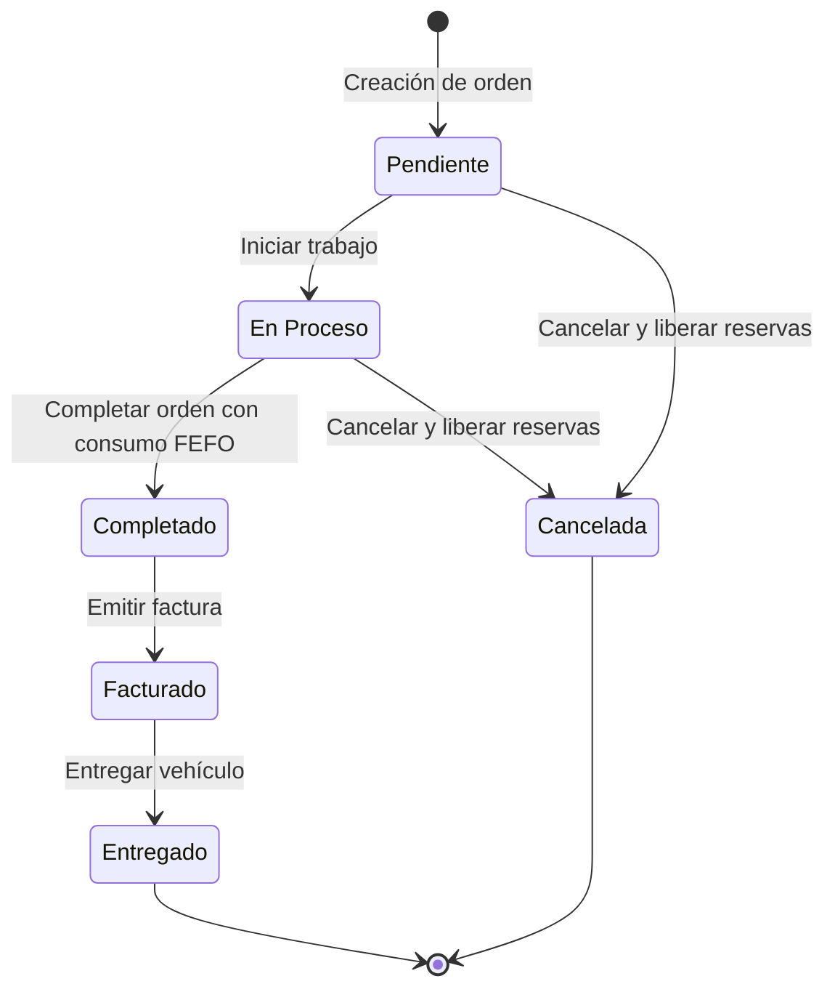

# CarMotors SGT — Sistema de Gestión de Taller Automotriz


-25A162?style=flat-square&logo=junit5&logoColor=white)

**CarMotors SGT** es una aplicación de consola desarrollada en **Java 17** con persistencia relacional en **MySQL 8** mediante **JDBC puro** (sin ORM ni frameworks web). El sistema centraliza la operación integral de un taller automotriz: gestión de clientes y vehículos, catálogo y evaluación de proveedores, control de inventario por lotes con trazabilidad **FEFO**, asignación inteligente de técnicos, ciclo de vida transaccional de órdenes de servicio, facturación inmutable con emisión de comprobantes `.txt` en UTF-8 y reportes gerenciales.

---

## Tabla de Contenidos

- [Stack Tecnológico](#stack-tecnológico)
- [Arquitectura y Estructura del Repositorio](#arquitectura-y-estructura-del-repositorio)
- [Funcionalidades por Módulo](#funcionalidades-por-módulo)
- [Reglas de Negocio del Dominio](#reglas-de-negocio-del-dominio)
- [Modelo de Base de Datos y Diagramas UML](#modelo-de-base-de-datos-y-diagramas-uml)
- [Decisiones de Diseño e Ingeniería](#decisiones-de-diseño-e-ingeniería)
- [Instalación, Configuración y Ejecución](#instalación-configuración-y-ejecución)
- [Autores](#autores)

---

## Stack Tecnológico

| Componente | Tecnología / Versión | Detalle Técnico |
|---|---|---|
| **Lenguaje** | Java JDK 17 | `maven.compiler.release=17`, codificación `UTF-8` |
| **Construcción y Ejecución** | Apache Maven 3.8+ | Coordenadas `com.campuslands:Proyecto-Java-Grupo4:1.0-SNAPSHOT` y plugin `exec-maven-plugin:3.5.0` (`mainClass`: `com.carmotors.sgt.Main`) |
| **Motor de Base de Datos** | MySQL Server `8.0.16+` | Motor `InnoDB`, charset `utf8mb4`, collation `utf8mb4_0900_ai_ci` y restricciones `CHECK` nativas |
| **Conectividad SQL** | `com.mysql:mysql-connector-j:8.4.0` | JDBC puro con `PreparedStatement` y control explícito de transacciones |
| **Pruebas Automatizadas** | `org.junit.jupiter:junit-jupiter:5.11.4` | Suite completa con **40** clases de prueba y **367** casos ejecutados |

---

## Arquitectura y Estructura del Repositorio

El sistema implementa una arquitectura en capas estrictamente desacoplada siguiendo el patrón **MVC + Service + DAO**, con inyección explícita de dependencias desde `Main` como *Composition Root*.


### Separación de Responsabilidades por Capa

| Capa / Paquete | Responsabilidad Principal | Restricciones Arquitectónicas |
|---|---|---|
| `com.carmotors.sgt.view` | Menús interactivos por consola y captura validada de entradas mediante `ConsoleReader` e `InputValidator`. | **Nunca** invoca DAOs ni ejecuta lógica de negocio o cálculos financieros. |
| `com.carmotors.sgt.controller` | Coordina las peticiones entre las vistas y los servicios o `TallerFacade`, captura excepciones del dominio y retorna mensajes claros. | **Nunca** abre conexiones JDBC ni accede directamente a las interfaces DAO. |
| `com.carmotors.sgt.service` | Concentra el 100 % de las reglas de negocio, validaciones de dominio, patrones de diseño y demarcación de transacciones JDBC. | **Nunca** realiza lectura o escritura directa de menús por consola. |
| `com.carmotors.sgt.dao` y `.impl` | Contratos DAO e implementaciones JDBC puras basadas en `PreparedStatement` con soporte para recibir una `Connection` compartida. | **Nunca** decide reglas de negocio ni imprime salidas en consola. |
| `com.carmotors.sgt.model` | Entidades del dominio, DTOs de consulta/reporte y enumeraciones tipadas. | Objetos de transporte y dominio sin dependencias hacia consola o JDBC. |
| `com.carmotors.sgt.config` | Gestión centralizada de configuración externa y creación de conexiones JDBC (`ConnectionFactory`). | Carga segura desde classpath sin exponer credenciales en código fuente. |
| `com.carmotors.sgt.util` | Utilidades reutilizables para lectura robusta de consola (`ConsoleReader`), formateo tabular (`ConsoleTableFormatter`) y validación de formatos (`InputValidator`). | Funciones auxiliares transversales sin estado de negocio. |
| `com.carmotors.sgt.exception` | Jerarquía de excepciones propias del dominio encabezada por `CarMotorsException` (`RuntimeException`). | Permite recuperación controlada de errores sin abortar la consola. |

### Estructura de Directorios

El código fuente productivo cuenta con **161** tipos de producción y **13** archivos `package-info.java` (**174** archivos `.java` en total), acompañados de **40** clases de prueba:

```text
Proyecto-Java-Grupo4/
├── database/
│   ├── schema.sql                               # DDL completo (20 tablas, FK, UNIQUE, CHECK)
│   └── data.sql                                 # Dataset representativo para pruebas y demo
├── docs/
│   ├── arquitectura.png                         # Diagrama de arquitectura por capas
│   ├── diagrama-clases.png                      # Diagrama de clases UML del sistema
│   └── diagrama-er.png                          # Diagrama Entidad-Relación de MySQL
├── src/
│   ├── main/
│   │   ├── java/com/carmotors/sgt/
│   │   │   ├── Main.java                        # Composition Root y punto de entrada
│   │   │   ├── config/
│   │   │   │   └── ConnectionFactory.java       # Singleton de configuración y conexiones JDBC
│   │   │   ├── controller/                      # 12 controladores de coordinación
│   │   │   ├── dao/                             # 21 interfaces DAO
│   │   │   │   └── impl/                        # 21 implementaciones JDBC con PreparedStatement
│   │   │   ├── exception/
│   │   │   │   ├── CarMotorsException.java      # Excepción base no chequeada del dominio
│   │   │   │   ├── ConfiguracionException.java
│   │   │   │   ├── DatoDuplicadoException.java
│   │   │   │   ├── EntidadNoEncontradaException.java
│   │   │   │   ├── StockInsuficienteException.java
│   │   │   │   ├── TransicionEstadoInvalidaException.java
│   │   │   │   └── ValidacionException.java
│   │   │   ├── model/                           # 47 entidades, DTOs de consulta/reporte y enums
│   │   │   ├── service/                         # 15 servicios de dominio
│   │   │   │   ├── builder/                     # Patrón Builder (FacturaTXTBuilder)
│   │   │   │   ├── chain/                       # Patrón Chain of Responsibility (sugerencia de técnicos)
│   │   │   │   ├── facade/                      # Patrón Facade (TallerFacade)
│   │   │   │   ├── observer/                    # Patrón Observer (alertas de stock bajo)
│   │   │   │   └── state/                       # Patrón State (ciclo de vida de órdenes)
│   │   │   ├── util/
│   │   │   │   ├── ConsoleReader.java
│   │   │   │   ├── ConsoleTableFormatter.java
│   │   │   │   └── InputValidator.java
│   │   │   └── view/                            # Interfaz SubmenuVista + 13 vistas de consola
│   │   └── resources/
│   │       └── config.properties.example        # Plantilla de configuración externa
│   └── test/
│       └── java/com/carmotors/sgt/              # 40 clases de pruebas unitarias y de integración
├── .gitignore
├── pom.xml
└── README.md
```

---

## Funcionalidades por Módulo

El punto de navegación principal reside en `ConsolaMenuView`, el cual integra los **7 módulos operativos** del taller mediante el contrato común `SubmenuVista`:

### 1. Clientes y Vehículos (`ClienteView`)
- Listado de clientes activos o del padrón completo.
- Búsqueda por identificador interno o documento de identidad (cédula o NIT).
- Registro y actualización de clientes (conservando campos opcionales previos al presionar Enter vacío) con activación y desactivación lógica.
- Registro de vehículos validando placa única y asociación a un cliente válido.
- Consulta de vehículos asociados a un cliente y búsqueda directa por placa.
- Consulta del historial integral del cliente (vehículos registrados, órdenes de servicio y facturas).

### 2. Proveedores (`ProveedorView`, `EvaluacionProveedorView`, `CatalogoProveedorView`)
- Gestión completa (CRUD) y activación/desactivación lógica de proveedores. Al desactivar un proveedor se limpian de forma atómica sus marcas `es_habitual` en el catálogo.
- Registro de evaluaciones de desempeño (calidad y puntualidad en escala `1..5`), consulta de historial, cálculo de promedios y ranking de proveedores.
- Administración del catálogo proveedor-repuesto: asociación de repuestos activos con costo y tiempo de entrega en días, actualización de condiciones comerciales, desasociación y designación de un único proveedor habitual por repuesto.
- Comparativa consolidada de proveedores disponibles para un repuesto específico.

### 3. Inventario y Lotes (`RepuestoView`, `LoteView`)
- Gestión (CRUD) y activación/desactivación lógica de repuestos.
- Filtrado combinable en memoria mediante **Stream API** por nombre, tipo de repuesto, marca y proveedor.
- Consulta detallada de existencias por repuesto (`stock físico`, `stock operativo`, `reservado`, `disponible` y `déficit`).
- Reporte de repuestos con stock igual o inferior al mínimo configurado.
- Ingreso transaccional y trazabilidad de lotes por código único o repuesto (incluyendo fechas de ingreso y caducidad opcional).
- Reporte de lotes vencidos y próximos a vencer.

### 4. Técnicos y Especialidades (`TecnicoView`)
- Registro, actualización, activación y desactivación lógica de técnicos asociados a especialidades catalogadas (*Mecánica general*, *Motor*, *Frenos*, *Eléctrica*, *Suspensión y dirección*).
- Consulta de carga de trabajo activa por técnico en órdenes abiertas.

### 5. Servicios y Órdenes de Trabajo (`ServiciosMenuView`, `ServicioTipoView`, `OrdenServicioView`)
- Catálogo de tipos de servicio clasificados en preventivos (con intervalo de mantenimiento en meses) y correctivos, asociados a su especialidad requerida y precio base de mano de obra.
- Creación transaccional multi-línea de órdenes de servicio para un vehículo.
- Edición de órdenes en estados habilitados: agregar o retirar líneas de servicio, ajustar el costo de mano de obra antes de completar, asignar técnicos con **sugerencia automática inteligente**, registrar horas trabajadas y reservar o retirar repuestos por línea.
- Listado con filtros combinables mediante **Stream API** y consulta de detalle consolidado de la orden.
- Control estricto de transiciones de estado: `En Proceso`, `Completado`, `Cancelar` y `Entregar`.

### 6. Facturación (`FacturacionView`)
- Generación transaccional de factura para órdenes en estado `Completado` (transicionando la orden a `Facturado` de forma atómica).
- Consulta de facturas por ID de factura, número consecutivo (`F-AAAA-NNNN`) o ID de orden asociada.
- Listado general de facturas emitidas.
- Generación, reintento ante fallos de disco y reimpresión idempotente del comprobante de texto en UTF-8 dentro de la carpeta configurada (`output/`).

### 7. Reportes Gerenciales (`ReportesView`)
- Consumo de repuestos por rango de fechas.
- Servicios más solicitados utilizando los nombres históricos congelados (*snapshots*) de cada línea de orden.
- Productividad por técnico prorrateada según las horas trabajadas registradas (incluyendo técnicos activos con carga cero).
- Recordatorios de mantenimiento preventivo próximos a cumplirse según el intervalo configurado en el servicio y la última entrega del vehículo.

---

## Reglas de Negocio del Dominio

### Cálculo de Stock sin Redundancia

El stock físico nunca se almacena como una columna redundante en `repuestos`; todas las métricas se calculan dinámicamente a partir de `lotes` y `repuestos.cantidad_reservada`:

- **`stock_fisico`** = `SUM(lotes.cantidad_actual)` (total de unidades en todos los lotes)
- **`stock_operativo`** = `SUM(lotes.cantidad_actual)` excluyendo lotes vencidos (`fecha_caducidad < CURDATE()`)
- **`reservado`** = `repuestos.cantidad_reservada` (unidades comprometidas por órdenes en estado `Pendiente` o `En Proceso`)
- **`disponible`** = `MAX(0, stock_operativo - reservado)`

> [!WARNING]
> Cuando el vencimiento de lotes genera un **déficit operativo** (`stock_operativo < reservado`), el sistema bloquea automáticamente nuevas reservas de ese repuesto y restringe el completado de las órdenes afectadas hasta que se reponga stock vigente o se retire el repuesto de la línea.

### Algoritmo FEFO Determinista de 4 Criterios (`ConsumoLotesFefo`)

Al completar una orden de servicio, los lotes vencidos (`fecha_caducidad IS NOT NULL AND fecha_caducidad < CURDATE()`) quedan excluidos del consumo. Los lotes vigentes con unidades disponibles se descuentan siguiendo estrictamente estos cuatro criterios de ordenamiento:

1. **Prioridad de caducidad:** lotes **con** `fecha_caducidad` definida antes que lotes **sin** `fecha_caducidad` (`fecha_caducidad IS NULL` al final).
2. **Proximidad de vencimiento:** `fecha_caducidad ASC` (vence primero, se consume primero).
3. **Antigüedad de ingreso:** `fecha_ingreso ASC` (en empate de caducidad o ambos sin caducidad, sale primero el lote ingresado antes).
4. **Desempate determinista:** `id ASC` (menor identificador primario del lote).

### Transacciones JDBC Atómicas

Toda operación de negocio que modifica dos o más tablas (o requiere consistencia entre lectura y actualización) se ejecuta dentro de una única `Connection` obtenida desde `ConnectionFactory`, configurada con `setAutoCommit(false)`, bloqueo pesimista `FOR UPDATE` en filas críticas, `commit()` explícito al concluir sin errores y `rollback()` garantizado ante cualquier excepción:

- Ingreso de lotes y registro asociado en inventario.
- Cambio de proveedor habitual único por repuesto.
- Desactivación lógica de proveedores con limpieza atómica de marcas `es_habitual`.
- Creación integral, edición de líneas, reserva/retiro de repuestos, cancelación y completado de órdenes de servicio (consumo FEFO + descuento de `cantidad_reservada` + transición de estado).
- Emisión de factura (`facturas`, `factura_snapshot`, `factura_detalles` y actualización de orden a `Facturado`).

### Precisión Monetaria, IVA e Inmutabilidad Histórica

- **Moneda y redondeo:** Todos los cálculos monetarios en pesos colombianos (COP) emplean exclusivamente `java.math.BigDecimal` con escala `2` y `RoundingMode.HALF_UP`. Está prohibido el uso de `float` o `double` para importes financieros.
- **Tasa de IVA fija:** La tasa impositiva fija es del **19 %** (`0.19`), definida como constante de negocio en `FacturaService.TASA_IVA` y persistida en la columna `facturas.tasa_iva`.
- **Snapshots de orden:** Al asignar servicios y repuestos en una orden de servicio, se congelan `nombre_servicio_snapshot`, `nombre_repuesto_snapshot` y `precio_unitario_venta` para aislar la orden ante futuros cambios de catálogo o precios.
- **Inmutabilidad de facturación:** Al facturar una orden `Completado`, la transacción persiste de forma atómica `facturas` (relación 1:1 con la orden), exactamente un registro en `factura_snapshot` (copia inmutable del cliente y vehículo) y al menos un detalle en `factura_detalles` (`MANO_OBRA` o `REPUESTO`). Una vez confirmado el `commit()`, el sistema genera el comprobante `output/factura_<numero>.txt` en codificación `UTF-8` mediante escritura atómica en disco.

### Máquina de Estados de Órdenes de Servicio

El ciclo de vida de cada orden sigue un flujo unidireccional estricto sin saltos ni retrocesos, con cancelación permitida únicamente mientras no haya sido completada (liberando las reservas comprometidas sin consumir lotes):



---

## Modelo de Base de Datos y Diagramas UML

El esquema relacional definido en `database/schema.sql` consta de **20 tablas** en **MySQL 8.0.16+** (`InnoDB`, `utf8mb4`, `utf8mb4_0900_ai_ci`), protegiendo la integridad directamente desde SQL mediante restricciones `CHECK`, claves `UNIQUE`, claves primarias compuestas, claves foráneas estrictas y cascadas controladas (`ON DELETE CASCADE` en asignaciones de detalle):

| Dominio | Cantidad | Tablas |
|---|---|---|
| **Catálogos de consulta** | 4 | `servicio_estados`, `mantenimiento_tipos`, `repuesto_tipos`, `especialidades` |
| **Clientes y vehículos** | 2 | `clientes`, `vehiculos` |
| **Técnicos y catálogo de servicios** | 2 | `tecnicos`, `servicio_tipos` |
| **Proveedores, repuestos y lotes** | 5 | `proveedores`, `repuestos`, `proveedor_repuestos` (PK compuesta), `lotes`, `evaluaciones_proveedor` |
| **Órdenes de servicio** | 4 | `ordenes_servicio`, `orden_servicio_detalle`, `detalle_tecnicos` (PK compuesta), `detalle_repuestos` (PK compuesta) |
| **Facturación inmutable** | 3 | `facturas` (1:1 con orden), `factura_snapshot` (1:1 con factura), `factura_detalles` (FK compuesta opcional hacia `detalle_repuestos`) |

### Conjunto de Datos Inicial (`database/data.sql`)

El script de datos semilla carga un escenario realista y listo para operar inmediatamente:
- **12** clientes y **18** vehículos.
- **8** proveedores y **12** evaluaciones registradas.
- **20** repuestos y **30** lotes (incluyendo lotes vigentes, próximos a vencer, vencido con saldo para pruebas de exclusión FEFO y lotes sin caducidad).
- **6** técnicos distribuidos en **5** especialidades y **8** tipos de servicio.
- **12** órdenes de servicio distribuidas en los **6 estados** del ciclo de vida (**3** `Pendiente`, **2** `En Proceso`, **2** `Completado`, **1** `Facturado`, **3** `Entregado` y **1** `Cancelada`).
- **4** facturas emitidas listas para consulta y generación/reimpresión de comprobante `.txt` (incluyendo un caso de facturación únicamente por mano de obra).

### Diagrama Entidad-Relación (ER)


### Diagrama de Clases UML


---

## Decisiones de Diseño e Ingeniería

### Patrones de Diseño Implementados

| Patrón | Categoría | Clases y Paquete en el Proyecto | Propósito en CarMotors SGT |
|---|---|---|---|
| **Singleton** | Creacional | `ConnectionFactory` (`com.carmotors.sgt.config`) | Carga la configuración de `config.properties` una única vez en memoria con acceso `synchronized` y provee conexiones JDBC independientes por operación. |
| **Builder** | Creacional | `FacturaTXTBuilder` (`com.carmotors.sgt.service.builder`) | Construye paso a paso el comprobante interno de texto (`conEncabezado`, `conClienteYVehiculo`, `conConceptos`, `conTotales`, `construir`). |
| **Facade** | Estructural | `TallerFacade` (`com.carmotors.sgt.service.facade`) | Unifica los flujos complejos que coordinan `OrdenServicioService`, `InventarioService` y `TecnicoService` (creación integral y completado con notificación de stock bajo). |
| **DAO** | Arquitectónico / Datos | 21 interfaces en `com.carmotors.sgt.dao` + 21 `*DAOImpl` en `dao.impl` | Aísla todas las sentencias SQL (`PreparedStatement`) del dominio y soporta inyección de conexión transaccional compartida. |
| **State** | Comportamiento | `EstadoOrden`, `EstadoOrdenBase`, `EstadoOrdenFactory`, `EstadoPendiente`, `EstadoEnProceso`, `EstadoCompletado`, `EstadoFacturado`, `EstadoEntregado`, `EstadoCancelada` (`com.carmotors.sgt.service.state`) | Encapsula las transiciones válidas y permisos de edición de cada estado de una orden, lanzando `TransicionEstadoInvalidaException` ante transiciones prohibidas. |
| **Chain of Responsibility** | Comportamiento | `ManejadorSugerencia`, `ManejadorEspecialistaLibre`, `ManejadorEspecialistaMenorCarga`, `ManejadorGeneralMenorCarga`, `SugerenciaTecnicoChain`, `SugerenciaTecnico` (`com.carmotors.sgt.service.chain`) | Evalúa secuencialmente la asignación óptima de un técnico: (1) especialista libre, (2) especialista con menor carga activa y (3) técnico general con menor carga, desempatando por menor ID. |
| **Observer** | Comportamiento | `StockObserver`, `AlertaStockBajoObserver` (`com.carmotors.sgt.service.observer`) + `InventarioService` | Desacopla la evaluación de stock tras el consumo de repuestos de la emisión de alertas en consola cuando el disponible alcanza o cae bajo el mínimo. |
| **Observer (Notificación de Servicios)** | Comportamiento | `Sujeto`, `Observador`, `ObservadorLogServicio`, `ObservadorNotificacionCliente` (`com.carmotors.sgt.service.observer`) + `OrdenServicioService` + `EventoServicioCompletado` | Desacopla la finalización de órdenes de servicio del log interno en consola y del registro de notificaciones al cliente en `notificaciones_clientes.txt`, permitiendo añadir futuros canales (SMS, WhatsApp) sin modificar el módulo de servicios (OCP). |

### Principios SOLID Aplicados

- **S — Responsabilidad Única (SRP):** `ConsumoLotesFefo` calcula exclusivamente qué unidades descontar de cada lote sin acceder a JDBC ni consola; `FacturaTXTBuilder` maqueta el formato de texto sin intervenir en persistencia o cálculos fiscales.
- **O — Abierto/Cerrado (OCP):** El árbol `EstadoOrden`, los eslabones de `ManejadorSugerencia` y los suscriptores `StockObserver` permiten incorporar nuevos estados, criterios de asignación de técnicos o canales de notificación sin modificar los flujos existentes.
- **L — Sustitución de Liskov (LSP):** `EstadoOrdenBase` y las seis implementaciones concretas (`EstadoPendiente` a `EstadoCancelada`) son completamente intercambiables bajo el contrato `EstadoOrden`; del mismo modo, todas las vistas modulares implementan `SubmenuVista` para ser ejecutadas uniformemente por `ConsolaMenuView`.
- **I — Segregación de Interfaces (ISP):** Contratos pequeños y cohesivos como `ServicioEstadoDAO` (solo lectura de catálogo), `StockObserver` (un único evento `onStockBajo`) y `SubmenuVista` (dos métodos esenciales de integración con el menú).
- **D — Inversión de Dependencias (DIP):** Las clases de servicio dependen exclusivamente de interfaces DAO (`com.carmotors.sgt.dao`) recibidas por constructor. `Main.java` actúa como *Composition Root* ensamblando e inyectando toda la jerarquía de DAOs, servicios, controladores y vistas.

### Programación Funcional, Manejo de Excepciones y Logging

- **Lambdas y Stream API:** Se emplean para filtrado combinable en memoria sobre catálogos de repuestos y órdenes de servicio, así como en agregaciones y ordenamientos de reportes después de consultas SQL acotadas.
- **Manejo estructurado de excepciones:** Todas las condiciones anómalas recuperables se modelan mediante la jerarquía no chequeada `CarMotorsException` (`RuntimeException`) y sus seis excepciones especializadas (`ConfiguracionException`, `DatoDuplicadoException`, `EntidadNoEncontradaException`, `StockInsuficienteException`, `TransicionEstadoInvalidaException`, `ValidacionException`), evitando el uso de `System.exit()` en servicios o repositorios y manteniendo estable la sesión de consola.
- **Trazabilidad técnica (`Logger`):** Eventos operativos relevantes (como fallos recuperables al generar archivos de factura en disco o advertencias SQL) se registran mediante `java.util.logging.Logger` sin exponer credenciales ni datos sensibles.

### Examen final 1732 | Notificación al cliente con Observer
Estudiante y grupo: Julio (`@julio7879`) | Grupo 4
Proyecto de origen: https://github.com/julio7879/Proyecto-Java-Grupo4
Acceso: `com.carmotors.sgt.Main` → `5. Servicios y Órdenes de Trabajo` → `2. Órdenes de servicio` → `12. Completar Orden de Servicio`
Clases del examen: `src/main/java/com/carmotors/sgt/service/observer/Sujeto.java`, `src/main/java/com/carmotors/sgt/service/observer/Observador.java`, `src/main/java/com/carmotors/sgt/service/observer/ObservadorLogServicio.java`, `src/main/java/com/carmotors/sgt/service/observer/ObservadorNotificacionCliente.java`, `src/main/java/com/carmotors/sgt/model/EventoServicioCompletado.java`, `src/main/java/com/carmotors/sgt/service/OrdenServicioService.java`, `src/main/java/com/carmotors/sgt/Main.java`, `src/main/java/com/carmotors/sgt/view/ServiciosMenuView.java`, `src/main/java/com/carmotors/sgt/view/OrdenServicioView.java`

Se implementó un sistema de notificaciones proactivo y desacoplado aplicando el **patrón de diseño Observer** para garantizar su extensibilidad (principio Abierto/Cerrado — OCP). `OrdenServicioService` actúa como sujeto concreto implementando `Sujeto`, conserva la lista de observadores registrados en el arranque desde `Main` y notifica automáticamente a todos los suscriptores tras confirmar el cambio de estado de una orden a `Completado`. En esta primera fase se integran dos observadores independientes: `ObservadorLogServicio` (imprime el registro interno del taller por consola) y `ObservadorNotificacionCliente` (crea o añade líneas con fecha y hora en `notificaciones_clientes.txt` en la raíz del proyecto). Incorporar canales futuros como SMS o WhatsApp únicamente requiere añadir nuevas clases que implementen `Observador` y suscribirlas al servicio, sin modificar la lógica de `OrdenServicioService`.

---

## Instalación, Configuración y Ejecución

### Prerrequisitos

- **Java Development Kit (JDK):** 17 o superior (`java -version`)
- **Apache Maven:** 3.8 o superior (`mvn -version`)
- **MySQL Server:** **8.0.16** o superior (`mysql --version`) — requerido por el uso de restricciones `CHECK` en `schema.sql`

### 1. Clonar el Repositorio

```bash
git clone https://github.com/julio7879/Proyecto-Java-Grupo4.git
cd Proyecto-Java-Grupo4
```

### 2. Crear y Poblar la Base de Datos

El script `database/schema.sql` crea la base de datos `carmotors` con codificación `utf8mb4` y todas las tablas; posteriormente, `database/data.sql` inserta los datos de prueba.

#### Linux / macOS (Bash)

```bash
mysql -u root -p --default-character-set=utf8mb4 < database/schema.sql
mysql -u root -p --default-character-set=utf8mb4 < database/data.sql
```

#### Windows (PowerShell)

*(Si el comando `mysql` no está en tu `PATH`, reemplázalo por `& "C:\Program Files\MySQL\MySQL Server 8.0\bin\mysql.exe"`.)*

```powershell
Get-Content -Raw -Encoding UTF8 database\schema.sql | mysql -u root -p --default-character-set=utf8mb4
Get-Content -Raw -Encoding UTF8 database\data.sql | mysql -u root -p --default-character-set=utf8mb4
```

### 3. Configurar Credenciales Externas (`config.properties`)

Copia la plantilla de configuración para crear el archivo de propiedades local que leerá `ConnectionFactory` desde el classpath:

#### Linux / macOS (Bash)

```bash
cp src/main/resources/config.properties.example src/main/resources/config.properties
```

#### Windows (PowerShell)

```powershell
Copy-Item src\main\resources\config.properties.example src\main\resources\config.properties
```

Edita `src/main/resources/config.properties` con tus credenciales locales de MySQL:

```properties
db.url=jdbc:mysql://localhost:3306/carmotors
db.user=root
db.password=TU_CONTRASEÑA
factura.carpeta=output
```

> [!IMPORTANT]
> El archivo real `src/main/resources/config.properties` (así como la carpeta generada `output/` de comprobantes `.txt`) se encuentra excluido en `.gitignore` para proteger las credenciales locales y evitar su exposición en el control de versiones.

### 4. Compilar y Ejecutar la Aplicación

El proyecto utiliza `exec-maven-plugin:3.5.0` preconfigurado para lanzar `com.carmotors.sgt.Main`.

#### Linux / macOS (Bash)

```bash
mvn clean compile exec:java
```

#### Windows (PowerShell)

Para visualizar correctamente tildes, la letra `ñ` y símbolos especiales en la consola de Windows, configura la página de códigos y la codificación UTF-8 de la JVM antes de iniciar Maven:

```powershell
chcp 65001
$env:MAVEN_OPTS = "-Dfile.encoding=UTF-8"
mvn clean compile exec:java
```

### 5. Ejecutar la Suite de Pruebas

Para ejecutar las **40** clases de pruebas unitarias y de integración (**367** casos de prueba con JUnit 5):

```bash
mvn clean test
```

---

## Autores

Proyecto desarrollado por el **Grupo 4**:

| Integrante | Usuario GitHub | Rol en el Proyecto |
|---|---|---|
| **Julio** | [`@julio7879`](https://github.com/julio7879) | Líder de Proyecto y Arquitectura |
| **Andrés Jiménez** | [`@AlmX4`](https://github.com/AlmX4) | Desarrollador Backend |
| **Jhorman** | [`@JopsWtD`](https://github.com/JopsWtD) | Desarrollador Backend y Arquitectura |
| **Sofía** | [`@Sofi11017`](https://github.com/Sofi11017) | Desarrolladora Backend |
