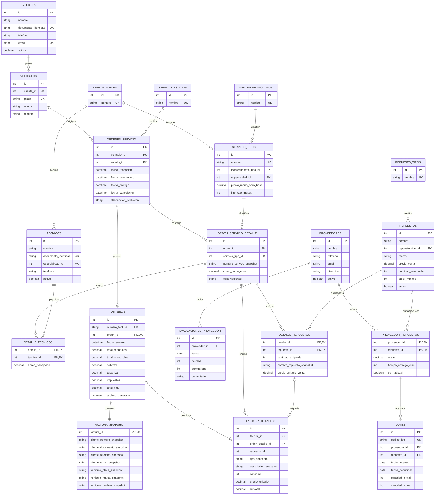
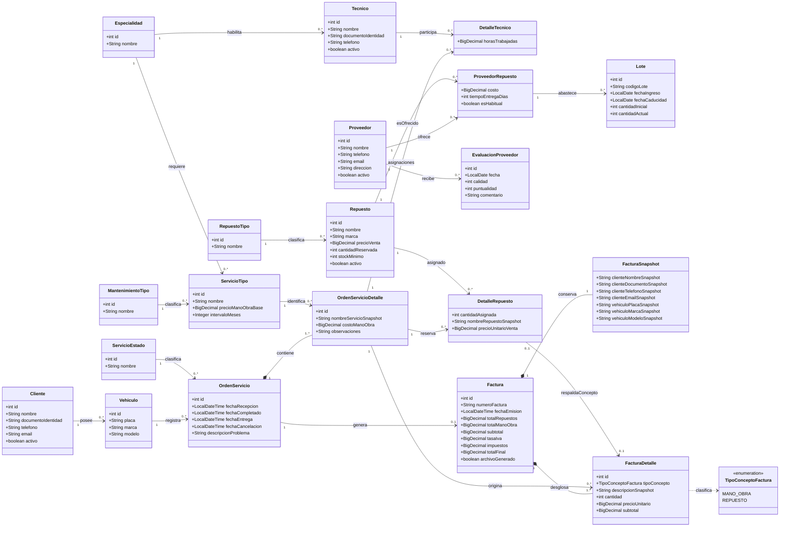

# CARMOTORS

## Sistema de Gestión de Taller (SGT)

**Documento maestro del proyecto**  
**Versión:** 1.3 — facturación normalizada y UML de dominio  
**Fecha de consolidación:** 13 de noviembre de 2026  
**Tecnologías objetivo:** Java 17 · Maven · MySQL 8 · JDBC  
**Interfaz:** aplicación de consola  
**Estado:** base de referencia del equipo para diseño y desarrollo

> **Propósito de este documento.** Este archivo reúne el alcance, los requerimientos, las reglas de negocio, las historias de usuario, las decisiones técnicas y el modelo lógico relacional de CarMotors. Debe utilizarse como referencia común para implementar el sistema. Cuando una decisión dependa de una confirmación del profesor, se identifica expresamente como supuesto del equipo o pendiente académico; no debe interpretarse como una exigencia docente confirmada.

---

## Control de versiones

| Versión | Fecha | Descripción |
|---|---|---|
| 1.0 | 12/11/2026 | Documento base con alcance, modelo de datos, requerimientos, reglas, historias y plan de trabajo. |
| 1.1 | 12/11/2026 | Revisión de consistencia de estados, inventario, reservas, facturación, reportes, transacciones y patrones. |
| 1.2 | 13/11/2026 | Consolidación del documento maestro, decisiones para un proyecto académico de cinco días, modelo lógico relacional y alineación con las sesiones de Java y la rúbrica compartida. |
| 1.3 | 13/11/2026 | Separación de la facturación en cabecera, snapshot del cliente/vehículo y líneas de factura; actualización del modelo lógico, cardinalidades, reglas, historias, pruebas y diagrama de clases UML derivado. |

### Precedencia del documento

1. Esta versión 1.3 sustituye como referencia de trabajo las versiones anteriores cuando exista una diferencia explícita.
2. El modelo lógico incluido aquí es la propuesta de referencia para el equipo. Todavía no es un modelo físico ni un script SQL.
3. No se recibió el SQL base mencionado en la revisión anterior ni el enunciado académico completo. Por tanto, no se afirma que este diseño ya haya sido contrastado con esos materiales.
4. Las decisiones que dependen del profesor se mantienen visibles en la sección **Decisiones académicas por confirmar**.

---

# 1. Introducción y alcance

El **Sistema de Gestión de Taller (SGT) de CarMotors** es una aplicación de consola desarrollada en Java 17 y conectada a MySQL 8 mediante JDBC. Su finalidad es organizar los datos de inventario, órdenes de servicio, clientes, vehículos, facturación interna, proveedores y técnicos de un taller.

El sistema debe permitir que un administrador registre las visitas de los vehículos, desglose los trabajos realizados en líneas de servicio, asigne técnicos y repuestos, reserve inventario, controle lotes y caducidades, genere comprobantes internos y consulte reportes operativos.

## 1.1 Alcance incluido

- Gestión de clientes y vehículos.
- Gestión de repuestos, tipos de repuesto, proveedores y catálogo proveedor-repuesto.
- Registro de ingresos de inventario por lotes, con proveedor, fechas y cantidades.
- Consultas de stock físico, stock operativo, reservas, disponibilidad, stock bajo y lotes por vencer o vencidos.
- Gestión de técnicos, especialidades y carga de trabajo.
- Creación y seguimiento de órdenes de servicio con una o varias líneas.
- Asignación de técnicos y repuestos a cada línea de servicio.
- Reserva de repuestos al asignarlos y descuento del inventario al completar una orden.
- Ciclo de estados: Pendiente, En Proceso, Completado, Facturado, Entregado y Cancelada.
- Generación, consulta y reimpresión de facturas internas en archivos TXT.
- Reportes de mantenimiento preventivo, servicios más solicitados, productividad, consumo de repuestos y desempeño de proveedores.
- Manejo de errores, excepciones propias y logs.

## 1.2 Restricciones y exclusiones

| Elemento | Decisión de alcance |
|---|---|
| Usuario | Un único perfil operativo: administrador del taller. No hay autenticación, inicio de sesión ni roles en esta versión. |
| Interfaz | Menús por consola. No se desarrolla interfaz gráfica, web ni aplicación móvil. |
| Persistencia | MySQL 8 mediante JDBC. No se utilizarán JPA, Hibernate ni frameworks ORM. |
| Facturación | Se registra la información en MySQL y se genera un TXT como comprobante académico interno. |
| DIAN | El TXT no es factura electrónica validada ni transmitida a la DIAN y no sustituye los requisitos tributarios de un sistema comercial. |
| Notificaciones | Las alertas y los recordatorios se presentan en consola como reportes. No se envían correos, SMS ni notificaciones externas. |
| Pagos | No se procesan pagos ni se integran pasarelas. |
| Concurrencia | No se implementan hilos ni sincronización Java en esta versión. Las transacciones JDBC sí son obligatorias. |
| Trazabilidad por lote | Se consulta el origen y saldo de cada lote y se descuenta mediante FEFO. No se mantiene una relación histórica de cada línea de servicio con el lote específico consumido; esa ampliación queda fuera del alcance de cinco días. |
| Consumo parcial | El sistema considera consumidos los repuestos cuando la orden pasa a Completado. No registra consumos parciales antes de ese estado. La cancelación o retiro de una reserva presupone que la pieza no fue instalada ni consumida físicamente. |

La información histórica debe conservarse. Los registros con historial no se eliminan físicamente; se desactivan cuando corresponda.

## 1.3 Objetivos funcionales

1. Controlar los repuestos disponibles, reservados y registrados en lotes, incluyendo caducidades.
2. Registrar una orden por visita del vehículo y permitir que incluya varios servicios.
3. Asignar técnicos y repuestos a cada línea de servicio, conservando horas, precios históricos y observaciones.
4. Administrar clientes, vehículos, proveedores y técnicos sin perder sus antecedentes.
5. Generar comprobantes internos y reportes operativos para apoyar la gestión del taller.
6. Aplicar correctamente POO, JDBC, transacciones, excepciones, SOLID, patrones, Lambdas y Stream API cuando respondan a necesidades reales del sistema.

## 1.4 Glosario

| Término | Significado dentro del proyecto |
|---|---|
| Orden de servicio | Registro de una visita de un vehículo al taller. Es la cabecera que agrupa una o varias líneas de servicio. |
| Línea de servicio | Trabajo concreto incluido en una orden, por ejemplo cambio de aceite o revisión de frenos. Tiene sus propios técnicos, repuestos y mano de obra. |
| Cabecera-detalle | Modelo en el que una tabla guarda los datos generales de la orden y otra sus líneas de servicio. |
| Relación M:N | Relación muchos a muchos. Se resuelve mediante una tabla intermedia. |
| Stock físico | Unidades que permanecen registradas en los lotes, incluidas las unidades reservadas y las que pertenezcan a lotes vencidos. |
| Stock operativo | Unidades restantes en lotes que no están vencidos. Son las unidades que pueden respaldar nuevas reservas o consumos. |
| Reserva | Cantidad apartada para una línea de servicio. Aumenta el total reservado, pero no descuenta las unidades físicas del lote. |
| Disponible | Cantidad operativa que puede comprometerse en nuevas reservas, una vez descontadas las reservas vigentes. |
| Lote | Grupo de unidades de un repuesto recibido de un proveedor en una fecha, con código y caducidad opcional. |
| FEFO | *First Expired, First Out*: se consumen primero los lotes con fecha de caducidad más próxima. |
| DAO | Objeto de acceso a datos. Encapsula consultas y operaciones JDBC de una entidad o agregado. |
| Capa de servicio | Capa que aplica reglas de negocio y coordina DAOs y transacciones. |
| Transacción | Conjunto de operaciones de base de datos que se confirman todas juntas o se revierten todas. |
| Snapshot | Copia de los datos relevantes en el momento de una operación, para conservar su valor histórico. |
| RF / RNF / RN | Requerimiento funcional / requerimiento no funcional / regla de negocio. |
| Criterio de aceptación | Condición comprobable que debe cumplirse para aceptar una funcionalidad. |
| Definition of Done (DoD) | Condiciones mínimas para considerar terminada una historia de usuario. |

---

# 2. Modelo de datos y decisiones de persistencia

El modelo utiliza una estructura **cabecera-detalle** para las órdenes. Una orden pertenece a un vehículo y contiene una o varias líneas de servicio. Los técnicos y los repuestos se asignan a cada línea. Los repuestos se relacionan con proveedores mediante una tabla M:N y los ingresos se registran por lotes.

El diagrama lógico es relacional: muestra tablas, atributos, claves primarias, claves foráneas, restricciones únicas y cardinalidades. No define todavía tipos SQL definitivos, índices físicos ni sentencias `CREATE TABLE`.

## 2.1 Modelo lógico relacional

**Convenciones:** `PK` = clave primaria; `FK` = clave foránea; `UK` = restricción única; `PK/FK` = atributo que forma parte de una clave primaria compuesta y a la vez es clave foránea.



### Lectura del diagrama

- `ORDEN_SERVICIO_DETALLE` es la tabla de líneas de servicio de cada orden.
- `DETALLE_TECNICOS` resuelve la relación M:N entre líneas de servicio y técnicos.
- `DETALLE_REPUESTOS` resuelve la relación M:N entre líneas de servicio y repuestos. La clave compuesta evita repetir el mismo repuesto dos veces en una misma línea; para reservar más unidades, se actualiza `cantidad_asignada`.
- `PROVEEDOR_REPUESTOS` resuelve la relación M:N entre proveedores y repuestos. La clave primaria compuesta evita repetir el mismo par.
- `LOTES` referencia el par `(proveedor_id, repuesto_id)` de `PROVEEDOR_REPUESTOS`. Así, cada lote pertenece a un proveedor que figura en el catálogo del repuesto.
- `FACTURAS.orden_id` es FK y UK: una orden puede tener cero o una factura, y una factura pertenece a una única orden.
- `FACTURAS` se separa de sus datos históricos y sus conceptos cobrados: `FACTURA_SNAPSHOT` conserva una copia de cliente/vehículo y `FACTURA_DETALLES` conserva cada concepto facturado.
- `FACTURA_SNAPSHOT.factura_id` es PK y FK: cada factura debe tener exactamente un snapshot y cada snapshot pertenece a una sola factura.
- `FACTURA_DETALLES.factura_id` es FK: cada factura debe tener uno o más conceptos facturados. El mínimo de una línea se valida en el servicio durante la transacción.
- Cada `FACTURA_DETALLES` se origina en una `ORDEN_SERVICIO_DETALLE`. Para `tipo_concepto = REPUESTO`, `repuesto_id` es obligatorio y, junto con `orden_detalle_id`, referencia la asignación correspondiente de `DETALLE_REPUESTOS`; para `MANO_OBRA`, `repuesto_id` es `NULL`.
- `DETALLE_REPUESTOS` puede tener cero o una línea de factura mientras la orden no se haya facturado; una vez facturada, cada asignación reservada se copia como concepto de repuesto.
- `Cancelada` forma parte del catálogo de estados y de las transiciones permitidas.

## 2.2 Diccionario lógico de entidades

Los nombres y atributos siguientes definen el diseño lógico. Los tipos concretos, longitudes, precisión decimal y acciones `ON DELETE` / `ON UPDATE` se concretarán en el modelo físico.

| Tabla | Claves | Atributos principales | Responsabilidad |
|---|---|---|---|
| `clientes` | `id` PK; `documento_identidad` UK; `email` UK | nombre, documento_identidad, telefono, email, activo | Datos del cliente; se conserva el historial al desactivar. |
| `vehiculos` | `id` PK; `cliente_id` FK; `placa` UK | cliente_id, placa, marca, modelo | Vehículos asociados a un cliente. |
| `servicio_estados` | `id` PK; `nombre` UK | nombre | Catálogo de estados de una orden. Incluye Cancelada. |
| `ordenes_servicio` | `id` PK; `vehiculo_id` FK; `estado_id` FK | fecha_recepcion, fecha_completado, fecha_entrega, fecha_cancelacion, descripcion_problema | Cabecera de cada visita y estado global de la orden. |
| `orden_servicio_detalle` | `id` PK; `orden_id` FK; `servicio_tipo_id` FK | nombre_servicio_snapshot, costo_mano_obra, observaciones | Una fila por servicio incluido en la orden. |
| `mantenimiento_tipos` | `id` PK; `nombre` UK | nombre | Catálogo Preventivo / Correctivo. |
| `especialidades` | `id` PK; `nombre` UK | nombre | Catálogo compartido por técnicos y tipos de servicio. |
| `servicio_tipos` | `id` PK; `nombre` UK; `mantenimiento_tipo_id` FK; `especialidad_id` FK | precio_mano_obra_base, intervalo_meses | Catálogo de servicios, especialidad requerida y parámetros de mantenimiento. |
| `tecnicos` | `id` PK; `documento_identidad` UK; `especialidad_id` FK | nombre, documento_identidad, telefono, activo | Personal que se puede asignar a líneas de servicio. |
| `detalle_tecnicos` | PK compuesta (`detalle_id`, `tecnico_id`); ambas FK | horas_trabajadas | Técnicos asignados a cada línea y horas registradas por técnico. |
| `repuesto_tipos` | `id` PK; `nombre` UK | nombre | Catálogo de categorías de repuestos. |
| `repuestos` | `id` PK; `repuesto_tipo_id` FK | nombre, marca, precio_venta, cantidad_reservada, stock_minimo, activo | Catálogo de repuestos y agregado de reservas. El stock físico y operativo se derivan de lotes; no se guarda `cantidad_stock` como saldo duplicado. |
| `proveedores` | `id` PK | nombre, telefono, email, direccion, activo | Datos de proveedores; se conserva su historial. |
| `proveedor_repuestos` | PK compuesta (`proveedor_id`, `repuesto_id`); ambas FK | costo, tiempo_entrega_dias, es_habitual | Catálogo M:N de repuestos ofrecidos y condiciones actuales por proveedor. |
| `lotes` | `id` PK; `codigo_lote` UK; FK compuesta (`proveedor_id`, `repuesto_id`) | fecha_ingreso, fecha_caducidad, cantidad_inicial, cantidad_actual | Existencias físicas restantes por ingreso y proveedor. `cantidad_actual` incluye unidades reservadas hasta que se consumen. |
| `evaluaciones_proveedor` | `id` PK; `proveedor_id` FK | fecha, calidad, puntualidad, comentario | Historial de evaluaciones de proveedores. |
| `detalle_repuestos` | PK compuesta (`detalle_id`, `repuesto_id`); ambas FK | cantidad_asignada, nombre_repuesto_snapshot, precio_unitario_venta | Repuestos asignados a una línea, cantidad reservada y precio/nombre histórico. Al completar la orden, `cantidad_asignada` se considera consumida. |
| `facturas` | `id` PK; `numero_factura` UK; `orden_id` FK y UK | fecha_emision, total_repuestos, total_mano_obra, subtotal, tasa_iva, impuestos, total_final, archivo_generado | Cabecera financiera de la factura y estado de generación del TXT. No contiene snapshots ni líneas de conceptos. |
| `factura_snapshot` | `factura_id` PK y FK | cliente_nombre_snapshot, cliente_documento_snapshot, cliente_telefono_snapshot, cliente_email_snapshot, vehiculo_placa_snapshot, vehiculo_marca_snapshot, vehiculo_modelo_snapshot | Copia histórica de los datos del cliente y del vehículo en el momento de emitir la factura. Relación obligatoria 1:1 con `facturas`. |
| `factura_detalles` | `id` PK; `factura_id` FK; `orden_detalle_id` FK; FK compuesta opcional (`orden_detalle_id`, `repuesto_id`) hacia `detalle_repuestos` | tipo_concepto, descripcion_snapshot, cantidad, precio_unitario, subtotal | Una fila por cada concepto cobrado: mano de obra o repuesto. La descripción, cantidad y precio quedan congelados al facturar. |

### Reglas de integridad específicas de facturación

- `facturas.orden_id` es único: no puede existir más de una factura por orden.
- Cada factura debe tener exactamente un registro en `factura_snapshot`. La relación se implementa con `factura_snapshot.factura_id` como PK y FK.
- Cada factura debe tener uno o más registros en `factura_detalles`. El mínimo de una fila no lo garantiza una FK y se valida en la capa de servicio antes de confirmar la transacción.
- `factura_detalles.tipo_concepto` admite `MANO_OBRA` o `REPUESTO`.
- Para `MANO_OBRA`, `repuesto_id` debe ser `NULL`, `cantidad` será 1 y `precio_unitario` corresponderá al costo de mano de obra de la línea de servicio.
- Para `REPUESTO`, `repuesto_id` debe tener valor y, junto con `orden_detalle_id`, debe identificar una asignación existente en `detalle_repuestos`. La combinación se protege mediante una FK compuesta en el modelo físico o, si la implementación del motor requiere una alternativa, mediante validación transaccional documentada.
- Una factura se construye copiando los valores históricos desde la orden completada: cada línea de servicio genera un concepto de mano de obra y cada repuesto asignado genera un concepto de repuesto.
- Los conceptos de `factura_detalles` son una copia histórica independiente de los datos actuales del catálogo. No se modifican después de confirmar la factura.

## 2.3 Catálogos de consulta

Los catálogos se cargan inicialmente desde `database/data.sql`. En esta versión no se exige un módulo de consola para administrar los tipos de servicio, tipos de repuesto, estados, tipos de mantenimiento o especialidades. Cualquier ampliación debe realizarse de forma controlada.

| Catálogo | Valores iniciales / condición |
|---|---|
| `servicio_estados` | Pendiente, En Proceso, Completado, Facturado, Entregado, Cancelada. |
| `mantenimiento_tipos` | Preventivo, Correctivo. |
| `repuesto_tipos` | Mecánico, Eléctrico, Carrocería, Consumo (aceites, filtros), entre otros. |
| `especialidades` | Mecánica general, Motor, Frenos, Eléctrica, Suspensión y dirección, Carrocería. |

Condiciones del catálogo `servicio_tipos`:

- Si el tipo de mantenimiento es **Preventivo**, `intervalo_meses` debe ser mayor que cero.
- Si el tipo de mantenimiento es **Correctivo**, `intervalo_meses` debe ser `NULL`.
- El precio base de mano de obra no puede ser negativo.

## 2.4 Relaciones y cardinalidades

| Relación | Cardinalidad | Implementación |
|---|---|---|
| Cliente — Vehículos | 1:0..N | `vehiculos.cliente_id` |
| Vehículo — Órdenes | 1:0..N | `ordenes_servicio.vehiculo_id` |
| Estado — Órdenes | 1:0..N | `ordenes_servicio.estado_id` |
| Orden — Líneas de servicio | 1:1..N | `orden_servicio_detalle.orden_id`; mínimo de una línea validado en servicio |
| Tipo de servicio — Líneas | 1:0..N | `orden_servicio_detalle.servicio_tipo_id` |
| Línea — Técnicos | M:N | `detalle_tecnicos` |
| Especialidad — Técnicos | 1:0..N | `tecnicos.especialidad_id` |
| Especialidad — Tipos de servicio | 1:0..N | `servicio_tipos.especialidad_id` |
| Tipo de mantenimiento — Tipos de servicio | 1:0..N | `servicio_tipos.mantenimiento_tipo_id` |
| Línea — Repuestos | M:N | `detalle_repuestos` |
| Tipo de repuesto — Repuestos | 1:0..N | `repuestos.repuesto_tipo_id` |
| Proveedor — Repuestos | M:N | `proveedor_repuestos` |
| Relación proveedor-repuesto — Lotes | 1:0..N | FK compuesta en `lotes` |
| Proveedor — Evaluaciones | 1:0..N | `evaluaciones_proveedor.proveedor_id` |
| Orden — Factura | 1:0..1 | `facturas.orden_id` único |
| Factura — Snapshot | 1:1 | `factura_snapshot.factura_id` es PK y FK |
| Factura — Detalles de factura | 1:1..N | `factura_detalles.factura_id`; mínimo de una línea validado en servicio |
| Línea de servicio — Detalles de factura | 1:0..N | `factura_detalles.orden_detalle_id`; una línea puede originar mano de obra y varios repuestos |
| Detalle de repuesto — Detalle de factura | 1:0..1 | FK compuesta opcional (`orden_detalle_id`, `repuesto_id`); la asignación se copia una sola vez al facturar |

Las cardinalidades `0..N` expresan que la relación puede no existir todavía. Por ejemplo, un cliente puede registrarse sin vehículos, un proveedor puede no tener evaluaciones y una orden Completada puede no tener factura hasta que el administrador la genere. En cambio, una orden debe tener `1..N` líneas y una factura emitida debe tener `1..N` conceptos. Estas cantidades mínimas se validan en la capa de servicio y dentro de las transacciones de creación correspondientes.

## 2.5 Fuente de verdad y cálculos de inventario

Los lotes son la fuente de verdad de las existencias físicas por ingreso. No se debe editar manualmente un saldo total sin crear o consumir un lote.

| Concepto | Definición |
|---|---|
| Stock físico | Suma de `lotes.cantidad_actual` de todos los lotes del repuesto. Incluye unidades reservadas y unidades de lotes vencidos que aún figuren físicamente. |
| Stock operativo | Suma de `lotes.cantidad_actual` de los lotes cuya caducidad sea `NULL` o igual/posterior a la fecha actual. Excluye lotes vencidos. |
| Reservado | Suma de las cantidades asignadas a líneas de órdenes Pendientes o En Proceso. El agregado `repuestos.cantidad_reservada` debe coincidir con esa suma. |
| Disponible para nuevas reservas | `MAX(0, stock_operativo - reservado)`. |
| Déficit de reservas | `MAX(0, reservado - stock_operativo)`. Se presenta como alerta cuando un lote vence y deja de respaldar las reservas existentes. |
| Unidades vencidas | Permanecen en el historial y en el stock físico, pero no se pueden reservar ni consumir. |

**Importante:** el diagrama no almacena `cantidad_stock` como atributo de `repuestos`, para evitar duplicar el saldo de los lotes. El stock físico y operativo se obtienen mediante consultas de agregación. `cantidad_reservada` sí se conserva como agregado operativo, pero debe actualizarse en la misma transacción que las reservas que representa. Si el equipo prefiere no almacenar ese agregado, deberá calcularlo desde `detalle_repuestos` y las órdenes activas; no deben coexistir dos fuentes contradictorias.

El reporte RF-07 debe mostrar al menos stock físico, stock operativo, reservado, disponible y mínimo. Si las reservas superan el stock operativo por vencimiento de lotes, debe mostrar el déficit y bloquear nuevas reservas y la finalización de órdenes afectadas hasta resolverlo.

## 2.6 Reserva y consumo por lote

1. Al asignar un repuesto a una línea, el sistema valida que el repuesto esté activo y que el stock operativo menos las reservas vigentes sea suficiente.
2. Si hay unidades, se registra `cantidad_asignada` en `detalle_repuestos` y aumenta `repuestos.cantidad_reservada` en la misma transacción.
3. La reserva se realiza por repuesto, no por lote específico. Por ello, una reserva no reduce `lotes.cantidad_actual` ni se atribuye anticipadamente a un lote.
4. Al completar una orden, se comprueba nuevamente que el stock operativo vigente pueda respaldar todas las cantidades de esa orden. Después se descuentan las unidades de los lotes no vencidos usando FEFO.
5. El orden determinista de consumo es: lotes con caducidad antes que los lotes sin caducidad; entre lotes con caducidad, fecha más próxima primero; en empate, fecha de ingreso más antigua; si también coincide, menor ID de lote. Los lotes sin caducidad se consumen al final, por fecha de ingreso más antigua y luego menor ID.
6. Al completar, se reduce `lotes.cantidad_actual` en las unidades consumidas y `repuestos.cantidad_reservada` en la reserva liberada/consumida. El registro de `detalle_repuestos` queda como evidencia de la cantidad asignada y consumida bajo el supuesto de consumo total al completar.
7. Si un lote vence después de haber creado una reserva y las existencias operativas dejan de respaldar todas las reservas, la orden no se completa. El administrador debe cancelar o ajustar las reservas afectadas o registrar existencias válidas antes de reintentar.
8. Si se cancela la orden, se elimina una línea permitida o se retira un repuesto antes de completar, se libera exactamente la reserva correspondiente.

### Límite de trazabilidad adoptado

Para mantener el alcance de un proyecto académico de cinco días, **no se incorpora la tabla `detalle_repuesto_lote`**. El sistema registra el proveedor, fechas, cantidad inicial y saldo restante de cada lote, y los saldos se actualizan con FEFO al completar órdenes. Sin embargo, no conserva una relación que permita responder qué lote exacto suministró cada unidad de una orden concreta.

Esta limitación es deliberada y debe mantenerse consistente en los RF: la trazabilidad de RF-03 es por lote (origen y saldo), no por vínculo histórico lote-orden. Si el profesor exige auditoría del lote consumido por cada servicio, se deberá ampliar el modelo con una tabla intermedia de consumo por lote y actualizar RF-03, RF-13, RF-27, las historias y las pruebas. No se debe agregar esa tabla silenciosamente durante la implementación.

## 2.7 Estructura histórica de la factura y reimpresión

La facturación se separa en tres tablas para que cada una tenga una responsabilidad clara y `facturas` no acumule todos los snapshots y conceptos cobrados:

1. **`facturas` — cabecera:** contiene el número, orden asociada, fecha de emisión, totales, tasa de IVA y marca de generación del archivo.
2. **`factura_snapshot` — datos históricos del cliente y vehículo:** contiene una copia de los datos de identificación y contacto del cliente y de la identificación del vehículo tal como estaban al facturar. Su PK también es FK a `facturas`, por lo que la relación es 1:1.
3. **`factura_detalles` — conceptos cobrados:** contiene una fila por concepto facturado. Un concepto es cada elemento individual que se cobra en la factura, no una tabla adicional de catálogo. Los tipos admitidos son `MANO_OBRA` y `REPUESTO`.

### Contenido de `factura_detalles`

| Campo | Uso |
|---|---|
| `id` (PK) | Identificador del concepto facturado. |
| `factura_id` (FK) | Factura a la que pertenece. |
| `orden_detalle_id` (FK) | Línea de servicio de la orden que origina el concepto. |
| `repuesto_id` (parte de FK compuesta, nullable) | Repuesto relacionado; es nulo para mano de obra y obligatorio para un concepto de repuesto. Junto con `orden_detalle_id` identifica la asignación de `detalle_repuestos`; no se crea una FK directa adicional a `repuestos`. |
| `tipo_concepto` | `MANO_OBRA` o `REPUESTO`. |
| `descripcion_snapshot` | Texto congelado que se imprime en la factura, por ejemplo `Mano de obra - Cambio de aceite` o `Filtro de aceite estándar`. |
| `cantidad` | Para mano de obra se registra 1; para repuestos, la cantidad asignada a la línea. |
| `precio_unitario` | Importe histórico por unidad. Para mano de obra es el costo de mano de obra de la línea; para repuesto es `precio_unitario_venta`. |
| `subtotal` | `cantidad × precio_unitario`, calculado y guardado con dos decimales. |

Cada línea de servicio de la orden produce un concepto de mano de obra. Además, cada repuesto asignado en esa línea produce un concepto de repuesto. Por eso una factura contiene uno o varios registros en `factura_detalles`, incluso cuando una línea no utiliza repuestos: en ese caso se factura únicamente la mano de obra.

La FK compuesta opcional `(orden_detalle_id, repuesto_id)` de `factura_detalles` hacia la PK compuesta de `detalle_repuestos` asegura que un concepto de tipo `REPUESTO` corresponda a un repuesto realmente asignado a esa línea. `repuesto_id` no necesita una FK directa adicional a `repuestos`, porque `detalle_repuestos.repuesto_id` ya referencia esa entidad. En los conceptos `MANO_OBRA`, `repuesto_id` queda `NULL`; el servicio valida que los campos coincidan con el tipo de concepto.

### Inmutabilidad y generación del TXT

- Al facturar, se copian los datos actuales del cliente y vehículo a `factura_snapshot`.
- Se copian los conceptos de la orden a `factura_detalles`, usando los nombres y precios históricos de `orden_servicio_detalle` y `detalle_repuestos`. La factura queda autosuficiente para su consulta y reimpresión; no depende de los nombres ni precios actuales de los catálogos.
- La cabecera, el snapshot, todos los detalles y el cambio de estado de la orden a `Facturado` se insertan/actualizan en una única transacción JDBC. Si falla cualquier operación de base de datos, se hace `ROLLBACK`.
- La factura debe contener exactamente un snapshot y al menos un detalle. Estas condiciones se comprueban antes del `COMMIT`.
- `archivo_generado` inicia en `false`. Después del `COMMIT`, el sistema genera `factura_<numero_factura>.txt` en UTF-8. Si la escritura termina correctamente, actualiza `archivo_generado` a `true`.
- Si falla la generación del archivo, la factura y sus datos históricos permanecen registrados. El administrador puede reintentar la generación desde `facturas`, `factura_snapshot` y `factura_detalles`, sin volver a facturar la orden.
- Si el archivo se escribió pero falló la actualización de la marca, reescribir el mismo nombre de archivo debe ser idempotente.

Los snapshots de `orden_servicio_detalle` y `detalle_repuestos` se mantienen porque protegen también el historial de la orden y los reportes previos a facturar. `factura_snapshot` y `factura_detalles` son copias deliberadas del momento de emisión: hacen que el comprobante no dependa de que el registro operativo original permanezca intacto para siempre.

## 2.8 Moneda, impuestos y precisión

- Moneda de presentación: pesos colombianos (COP).
- En Java se utiliza `BigDecimal`; nunca `double` o `float` para importes monetarios.
- Los importes se presentan y almacenan con dos decimales.
- Política uniforme de redondeo: `RoundingMode.HALF_UP` a dos decimales.
- Tasa del ejercicio: **19 % fijo como supuesto académico**. No se presenta como una conclusión tributaria para todos los servicios ni como requisito fiscal de una factura real.
- La tasa aplicada se guarda en la factura para que una reimpresión no cambie si el código evoluciona.
- No se calcula costo contable de inventario ni utilidad. RF-27 representa el valor comercial de los repuestos consumidos al precio de venta histórico.


## 2.9 Diagrama de clases UML derivado del modelo lógico

El siguiente diagrama representa las **clases del dominio persistente** a partir de las 20 tablas del modelo lógico actualizado. Las claves foráneas se expresan como asociaciones UML; no se repiten como atributos de clase cuando la relación ya las representa. Las tablas intermedias M:N se modelan como clases de asociación (`DetalleTecnico`, `DetalleRepuesto` y `ProveedorRepuesto`) porque contienen atributos propios.

El diagrama se concentra en atributos y relaciones. No inventa métodos de negocio: las operaciones de aplicación se implementarán en las clases de servicio, controladores y DAOs, y deberán diseñarse durante la arquitectura Java. `TipoConceptoFactura` se representa como enumeración porque restringe los tipos de fila de factura, aunque no constituye una tabla independiente.



### Criterios de lectura del UML

- Una `Factura` compone exactamente un `FacturaSnapshot` y uno o varios `FacturaDetalle`. La composición representa que esos registros históricos nacen con la factura y no tienen sentido independiente.
- Una `FacturaDetalle` siempre procede de una `OrdenServicioDetalle`. Puede ser de mano de obra o de repuesto; en el segundo caso debe corresponder a una asignación concreta de `DetalleRepuesto`.
- `DetalleTecnico`, `DetalleRepuesto` y `ProveedorRepuesto` son clases de asociación: materializan relaciones M:N y almacenan atributos que pertenecen a la relación, no solo a una de las entidades relacionadas.
- `Lote` se relaciona con `ProveedorRepuesto`, no libremente con cualquier combinación proveedor/repuesto. Así se conserva la regla de que el proveedor debe ofrecer el repuesto que ingresa.
- El diagrama UML no sustituye el diagrama lógico: el primero modela clases y asociaciones del dominio; el segundo especifica tablas, claves y restricciones de persistencia.

### Recursos editables y visuales

- Modelo lógico editable (Mermaid): [`CarMotors_Modelo_Logico_v1.3.mmd`](02-Arquitectura/diagramas/CarMotors_Modelo_Logico_v1.3.mmd). Los PNG/SVG se exportan desde ese archivo cuando se necesiten.
- Diagrama de clases UML editable (Mermaid): [`CarMotors_Diagrama_Clases_UML_v1.3.mmd`](02-Arquitectura/diagramas/CarMotors_Diagrama_Clases_UML_v1.3.mmd). Los PNG/SVG se exportan desde ese archivo cuando se necesiten.
- Los archivos `.dot` contienen la fuente Graphviz utilizada para generar los PNG y SVG.

---

# 3. Requerimientos funcionales

Los requerimientos funcionales describen las acciones que el sistema debe permitir. Se conservan los 35 identificadores del documento base y se precisan sus criterios para reducir interpretaciones diferentes durante el desarrollo.

**Prioridad Alta:** función central para que el sistema cumpla su alcance.  
**Prioridad Media:** función complementaria que mejora la operación, pero no desplaza las reglas críticas de inventario, órdenes y facturación.

## 3.1 Módulo 1 — Inventario

| ID | Requerimiento y alcance | Criterios de aceptación verificables | Prioridad |
|---|---|---|---|
| RF-01 | Registrar, consultar, actualizar y desactivar repuestos: nombre, tipo, marca, precio de venta y stock mínimo. El stock físico cambia únicamente mediante ingreso o consumo de lotes; no se edita manualmente. | Rechaza datos obligatorios vacíos y valores negativos. Un repuesto inactivo no admite nuevas reservas, pero conserva historial y reservas ya creadas. El stock inicial se ingresa mediante lotes de apertura. | Alta |
| RF-02 | Registrar el ingreso de un lote con código único, repuesto, proveedor, fecha de ingreso, caducidad opcional y cantidad. | Rechaza código duplicado, cantidad menor o igual a cero, caducidad anterior o igual al ingreso y proveedor que no ofrece el repuesto o está inactivo. El lote se guarda en una transacción. El stock derivado aumenta exactamente en la cantidad del lote. | Alta |
| RF-03 | Consultar los lotes de un repuesto y la trazabilidad de un lote: proveedor, fechas, cantidad inicial y cantidad restante. | Lista primero los lotes con fecha de caducidad más próxima; los lotes sin caducidad aparecen después, ordenados por fecha de ingreso. Un código inexistente muestra un mensaje claro. No se promete trazabilidad lote-orden individual en esta versión. | Alta |
| RF-04 | Buscar y filtrar repuestos por nombre, tipo, marca o proveedor. | La búsqueda ignora diferencias entre mayúsculas y minúsculas; los filtros se pueden combinar. Sin coincidencias, muestra un mensaje. | Media |
| RF-05 | Generar un reporte de repuestos activos cuyo disponible para nuevas reservas sea menor o igual al stock mínimo. | Muestra stock físico, stock operativo, reservado, disponible, mínimo y proveedor habitual. Si no hay proveedor habitual, muestra “No definido”. Sin resultados, informa que no hay repuestos bajo mínimo. | Alta |
| RF-06 | Generar un reporte de lotes que caducan dentro de los próximos N días (30 por defecto) o que ya están vencidos. | Incluye lotes con cantidad física restante mayor que cero. Distingue “por vencer” de “vencido” y muestra proveedor. Como las reservas no se asignan a lotes específicos, no atribuye reservas por lote. Los lotes sin caducidad no aparecen. | Alta |
| RF-07 | Mostrar por repuesto el stock físico total, el stock operativo, la cantidad reservada y el disponible para nuevas reservas. | Los valores se calculan con las definiciones de la sección 2.5. No presenta stock vencido como disponible. Si las reservas superan el stock operativo, muestra el déficit y una alerta. | Alta |

## 3.2 Módulo 2 — Servicios y órdenes

| ID | Requerimiento y alcance | Criterios de aceptación verificables | Prioridad |
|---|---|---|---|
| RF-08 | Crear una orden con vehículo, descripción del problema, fecha de recepción y al menos una línea de servicio. La orden inicia en Pendiente. | No guarda una orden sin vehículo existente y activo ni sin líneas. La fecha de recepción se establece con la fecha y hora actuales. Cabecera y líneas iniciales se guardan en una transacción. | Alta |
| RF-09 | Asignar uno o varios técnicos a cada línea. El sistema sugiere un técnico mediante RN-20; el administrador acepta la sugerencia o introduce otro ID. Se registran horas trabajadas. | Siempre muestra nombre, especialidad y carga del sugerido. Rechaza ID inexistente o técnico inactivo. Las horas no pueden ser negativas. Si la especialidad no coincide, exige confirmación, también para una sugerencia de respaldo. No duplica técnico en una línea. Si no hay técnicos activos, informa y permite cancelar la asignación. | Alta |
| RF-10 | Asignar repuestos y cantidades a cada línea. Las unidades quedan reservadas y el precio de venta queda copiado en la línea. | Rechaza cantidad menor o igual a cero o superior al disponible. Aumenta el reservado sin cambiar el stock físico de los lotes. Guarda el nombre y precio unitario vigentes al asignar. | Alta |
| RF-11 | Retirar un repuesto reservado de una línea de una orden Pendiente o En Proceso, liberando la reserva correspondiente. | No permite retirar repuestos de órdenes Completadas, Facturadas, Entregadas o Canceladas. En una orden En Proceso, el retiro presupone que la pieza no fue utilizada físicamente. El reservado disminuye exactamente en la cantidad liberada y se elimina la asignación del repuesto, no la línea de servicio. | Media |
| RF-12 | Cambiar el estado de una orden siguiendo el ciclo Pendiente → En Proceso → Completado → Facturado → Entregado. Cancelada es una salida excepcional desde Pendiente o En Proceso. | Permite únicamente transiciones autorizadas. No permite saltos ni retrocesos. Cada transición valida sus precondiciones y ejecuta los efectos correspondientes. Cancelada no admite cambios posteriores. | Alta |
| RF-13 | Al completar una orden, descontar de los lotes las cantidades reservadas de todas sus líneas, reducir las reservas y registrar la fecha de finalización. | Valida las líneas y la cobertura del stock operativo antes de confirmar. Descuenta por FEFO, reduce el agregado reservado y cambia el estado dentro de una misma transacción. No consume lotes vencidos. Si algo falla, nada cambia. No se registra una relación individual lote-orden en esta versión. Genera alerta de stock bajo cuando corresponda. | Alta |
| RF-14 | Cancelar una orden Pendiente o En Proceso liberando las reservas de todas sus líneas. | Solo permite cancelar desde esos dos estados. No consume repuestos ni genera factura. Conserva la orden, sus líneas y horas como historial. La orden cancelada no admite modificaciones ni se incluye en reportes de servicios completados. Se asume que no hubo consumo físico parcial. | Media |
| RF-15 | Listar órdenes filtrando por estado, técnico, vehículo, tipo de servicio o rango de fechas. | Los filtros se pueden combinar. El rango general utiliza fecha de recepción, salvo que el reporte especifique otra fecha. Sin resultados, muestra un mensaje. | Alta |
| RF-16 | Consultar el detalle de una orden: cliente, vehículo, estado y, por cada línea, técnicos, repuestos, cantidades, reservas/consumos, horas, mano de obra y subtotal. | Muestra datos históricos de la orden. El subtotal de línea corresponde a repuestos valorizados a precio de venta guardado más mano de obra. Un ID inexistente muestra un mensaje. | Alta |
| RF-35 | Agregar o quitar líneas de servicio a una orden que no esté completada, facturada, entregada ni cancelada. | En Pendiente se pueden agregar o quitar líneas, sin retirar la última. En En Proceso, una línea nueva debe quedar asignada al menos a un técnico activo antes de cerrar la operación de alta; solo se puede retirar una línea sin horas registradas y nunca la última línea de la orden. Al retirarla se liberan sus reservas. | Alta |

### Aclaración de RF-35

Se conserva la posibilidad de agregar una línea a una orden En Proceso porque aparece en la historia HU-04 del documento base. Para no dejar una línea activa sin responsable, la asignación de al menos un técnico debe completarse dentro del mismo flujo de incorporación. Una línea con horas registradas no se puede retirar y nunca se puede eliminar la última línea de una orden.

## 3.3 Módulo 3 — Clientes y vehículos

| ID | Requerimiento y alcance | Criterios de aceptación verificables | Prioridad |
|---|---|---|---|
| RF-17 | Registrar, consultar, actualizar y desactivar clientes con nombre, documento, teléfono y email. | Nombre, documento y email son obligatorios. Documento y email son únicos. Email debe tener formato válido. Desactivar impide crear nuevas órdenes o vehículos para el cliente, pero conserva su historial y permite consultar órdenes existentes. | Alta |
| RF-18 | Registrar y consultar vehículos asociados a un cliente: placa, marca y modelo. | La placa se guarda en mayúsculas y sin espacios; debe ser única. El cliente propietario debe existir y estar activo para registrar un vehículo. Un vehículo con órdenes asociadas no se elimina físicamente. | Alta |
| RF-19 | Buscar un cliente por documento o un vehículo por placa. | La búsqueda utiliza coincidencia exacta después de normalizar la entrada. Si no encuentra resultados, muestra un mensaje. | Alta |
| RF-20 | Mostrar el historial de un cliente: sus vehículos y todas las órdenes realizadas a cada uno. | Muestra órdenes de la más reciente a la más antigua, líneas de servicio, fecha, estado y total facturado cuando exista factura. Las órdenes no facturadas se muestran sin inventar un total facturado. | Alta |
| RF-21 | Generar el reporte de clientes cuyo mantenimiento preventivo esté próximo o vencido según el intervalo definido para el tipo de servicio. | Solo considera líneas preventivas de órdenes Entregadas con intervalo definido. Calcula fecha sugerida = fecha de entrega + intervalo en meses. Incluye vencidos y los próximos 30 días. Un servicio entregado más reciente del mismo tipo y vehículo reemplaza el anterior. | Alta |

## 3.4 Módulo 4 — Facturación y reportes

| ID | Requerimiento y alcance | Criterios de aceptación verificables | Prioridad |
|---|---|---|---|
| RF-22 | Generar una factura interna para una orden Completada, guardarla en MySQL y producir `factura_<numero_factura>.txt` en la carpeta de salida configurada para la aplicación. | Solo factura órdenes Completadas sin factura previa. Registra `facturas`, un `factura_snapshot` y uno o más `factura_detalles`, y cambia la orden a Facturado en una transacción. Después del `COMMIT` genera el TXT en UTF-8 y actualiza `archivo_generado`. Si falla el archivo, la factura permanece registrada y puede reintentarse. | Alta |
| RF-23 | Incluir número, fecha, datos históricos del cliente y vehículo y el desglose de cada línea mediante conceptos de mano de obra y repuestos, con descripción, cantidad, precio unitario y subtotal; al final, subtotal general, impuestos y total. | Los datos del cliente y vehículo se guardan en `factura_snapshot`; cada concepto se guarda como una fila en `factura_detalles`. Los valores se calculan con RN-12 y se guardan con dos decimales. La reimpresión utiliza exclusivamente los datos históricos de esas tablas, aunque los catálogos o datos operativos cambien después. | Alta |
| RF-24 | Consultar o reimprimir una factura existente. | Reimprime el mismo contenido desde `facturas`, `factura_snapshot` y `factura_detalles`, sin consultar valores actuales del catálogo para reconstruir los conceptos. No crea otra factura ni cambia el estado de la orden. Si el archivo no existe o no se pudo generar, permite reconstruirlo desde la información guardada. | Media |
| RF-25 | Generar un reporte de servicios más solicitados: cantidad de líneas e ingresos por tipo de servicio. | Filtra por fecha de finalización y cuenta órdenes Completadas, Facturadas o Entregadas. Los ingresos por línea son repuestos a precio de venta guardado más mano de obra, antes de impuestos. Ordena por cantidad descendente. | Alta |
| RF-26 | Generar un reporte de productividad por técnico: líneas completadas, horas trabajadas e ingresos de mano de obra atribuibles. | Cuenta órdenes Completadas o posteriores. Distribuye la mano de obra de cada línea entre sus técnicos en proporción a las horas registradas. Si la línea no tiene horas, el valor queda como mano de obra sin distribuir. Incluye técnicos históricos que tengan trabajo en el periodo y técnicos activos sin trabajo con cero. | Alta |
| RF-27 | Generar un reporte de consumo de repuestos por repuesto y tipo de servicio, en un rango de fechas. | Cuenta cantidades asignadas en órdenes Completadas o posteriores, porque bajo el supuesto del proyecto esa cantidad se consume íntegramente al completar. No cuenta reservas de órdenes Pendientes o En Proceso. El valor se calcula con el precio de venta histórico y representa valor comercial, no costo de adquisición ni utilidad. Ordena por valor descendente. | Alta |

## 3.5 Módulo 5 — Proveedores

| ID | Requerimiento y alcance | Criterios de aceptación verificables | Prioridad |
|---|---|---|---|
| RF-28 | Registrar, consultar, actualizar y desactivar proveedores con datos de contacto. | Nombre obligatorio; email con formato válido si se ingresa. La desactivación impide nuevos ingresos de lotes con ese proveedor, elimina su condición de proveedor habitual si la tenía y conserva lotes, evaluaciones y órdenes históricas. | Alta |
| RF-29 | Gestionar el catálogo M:N: qué repuestos ofrece cada proveedor, su costo, tiempo de entrega y si es el proveedor habitual. | Costo mayor que cero; tiempo de entrega no negativo; no se repite el par proveedor-repuesto. Cada repuesto tiene como máximo un proveedor habitual. Al marcar uno nuevo, se desmarca el anterior dentro de una transacción. | Alta |
| RF-30 | Comparar proveedores activos que ofrecen un mismo repuesto, ordenados por costo. | Muestra costo actual del catálogo, tiempo de entrega y promedio de evaluación. Proveedores sin evaluación aparecen identificados como “Sin evaluar” al final. Los inactivos se conservan en el historial, pero no se ofrecen como alternativa de nueva compra. | Media |
| RF-31 | Registrar evaluaciones de proveedores con calidad y puntualidad de 1 a 5. | Ambas calificaciones son enteros entre 1 y 5. La fecha actual se usa por defecto y el comentario es opcional. | Alta |
| RF-32 | Generar un ranking de proveedores según el promedio de sus evaluaciones. | Muestra promedio con un decimal y cantidad de evaluaciones. Proveedores sin evaluar aparecen al final como “Sin evaluar”. En empate, ordena por nombre para mantener resultados estables. | Alta |

## 3.6 Módulo de apoyo — Técnicos

| ID | Requerimiento y alcance | Criterios de aceptación verificables | Prioridad |
|---|---|---|---|
| RF-33 | Registrar, consultar, actualizar y desactivar técnicos con su especialidad. | Documento único y especialidad existente. Un técnico inactivo no se sugiere ni se asigna a nuevas líneas; sus asignaciones históricas permanecen. Si una orden sigue Pendiente, cada línea debe conservar al menos un técnico activo antes de pasar a En Proceso. Una orden ya En Proceso puede concluirse aunque luego se desactive uno de sus técnicos. | Alta |
| RF-34 | Ver las líneas de servicio asignadas a un técnico con orden, placa, tipo de servicio y estado. | Muestra líneas de órdenes no canceladas ni entregadas. Si no tiene carga actual, muestra un mensaje; el historial completado puede consultarse en reportes. | Media |

---

# 4. Reglas de negocio

Las reglas de negocio se implementan en la capa `service`. La vista puede validar el formato básico de una entrada y el DAO puede hacer cumplir restricciones de integridad, pero ninguna de esas capas sustituye las validaciones centralizadas en los servicios.

| ID | Regla |
|---|---|
| RN-01 | Solo se puede reservar un repuesto si el stock operativo menos las reservas vigentes es igual o superior a la cantidad solicitada. Stock operativo excluye lotes vencidos. Si no alcanza, se rechaza y se informa el disponible. |
| RN-02 | Al asignar un repuesto a una línea, aumenta `cantidad_reservada` por la cantidad asignada. El stock físico de repuestos y lotes no cambia. |
| RN-03 | Al completar una orden, por cada repuesto de cada línea se reduce el stock físico y el reservado por la cantidad asignada. El consumo se distribuye entre lotes no vencidos con FEFO: primero caduca antes; en empate, fecha de ingreso más antigua. Los lotes sin caducidad se consideran después de los lotes con fecha y se ordenan por ingreso más antiguo. Si también coincide la fecha de ingreso, se desempata por menor ID. El sistema actualiza los saldos de lote, pero no registra el vínculo lote-orden individual en esta versión. |
| RN-04 | El descuento de inventario de todas las líneas y el cambio de estado a Completado se ejecutan en una sola transacción JDBC. Si cualquier paso falla, se hace `ROLLBACK` y no se guarda ningún cambio. |
| RN-05 | Al retirar un repuesto, retirar una línea o cancelar una orden, se liberan exactamente las reservas asociadas. Una orden Completada, Facturada, Entregada o Cancelada no permite editar líneas ni repuestos. Una línea En Proceso con horas registradas no se puede retirar. La liberación presupone que la pieza no fue consumida físicamente antes de completar. |
| RN-06 | Los estados avanzan un paso a la vez: Pendiente → En Proceso → Completado → Facturado → Entregado. Cancelada es una excepción permitida únicamente desde Pendiente o En Proceso. No se permiten saltos ni retrocesos. |
| RN-07 | Para pasar una orden a En Proceso, cada línea debe tener al menos un técnico activo asignado. Si el único técnico asignado a una línea se desactiva antes de iniciar la orden, debe asignarse un técnico activo de reemplazo. Si se agrega una línea a una orden En Proceso, debe quedar asignada a al menos un técnico activo antes de cerrar la operación de alta. Desactivar un técnico después de iniciada la orden no invalida retroactivamente la asignación. |
| RN-08 | Cada línea debe tener costo de mano de obra mayor o igual a cero antes de completar. Al crear la línea se copia como valor inicial `precio_mano_obra_base` del tipo de servicio; el administrador puede ajustarlo antes de completar. Las horas del técnico se registran por separado y no determinan automáticamente ese precio. |
| RN-09 | Solo se factura una orden Completada y una sola vez. En una misma transacción se guarda una fila en `facturas`, exactamente una en `factura_snapshot`, una o más en `factura_detalles` y se cambia la orden a Facturado. Si falla cualquiera de estas operaciones, se revierte todo. |
| RN-10 | Solo se entrega una orden Facturada. Al entregarla, se registra `fecha_entrega` y se cambia el estado a Entregado. |
| RN-11 | El precio de venta del repuesto se copia en `precio_unitario_venta` al asignarlo. Los cambios posteriores en el catálogo no modifican órdenes ni facturas existentes. El nombre también queda guardado en `nombre_repuesto_snapshot`. |
| RN-12 | `total_repuestos = SUM(subtotal)` de los conceptos `REPUESTO` en `factura_detalles`; `total_mano_obra = SUM(subtotal)` de los conceptos `MANO_OBRA`; `subtotal = total_repuestos + total_mano_obra`; `impuestos = subtotal × 0.19`; `total_final = subtotal + impuestos`. Cada línea se copia desde los valores históricos de la orden a `factura_detalles`. Se manejan montos con `BigDecimal`, dos decimales y `HALF_UP`. El 19 % es un supuesto académico fijo del proyecto, no una validación tributaria. |
| RN-13 | Documento y email del cliente son únicos y obligatorios; la placa del vehículo es única. La placa se normaliza antes de validar y guardar. |
| RN-14 | El código de lote es único. Si existe fecha de caducidad, debe ser posterior a la fecha de ingreso. El proveedor debe ofrecer el repuesto y estar activo al registrar el lote. Un lote vencido nunca se usa para nuevas reservas ni para consumo. |
| RN-15 | El recordatorio se calcula por vehículo y tipo de servicio preventivo: fecha sugerida = `fecha_entrega` de la última orden Entregada que contiene ese tipo + `intervalo_meses`. Se informa si ya venció o si cae dentro de los próximos 30 días. Un servicio entregado más reciente del mismo tipo reemplaza la fecha anterior. |
| RN-16 | Calidad y puntualidad de cada evaluación son enteros de 1 a 5. El puntaje de una evaluación es el promedio de ambas; el puntaje del proveedor es el promedio de todas sus evaluaciones. |
| RN-17 | No se eliminan físicamente clientes, repuestos, técnicos o proveedores con historial. Se desactivan y sus datos históricos permanecen consultables. La desactivación no borra órdenes, lotes, asignaciones ni facturas. Un repuesto inactivo no admite nuevas reservas, pero conserva las ya creadas; un técnico inactivo no recibe nuevas asignaciones, pero las existentes se conservan. Los lotes vigentes de un proveedor inactivo pueden consumirse en órdenes ya creadas; no se admiten nuevos ingresos de ese proveedor. |
| RN-18 | Toda orden tiene al menos una línea de servicio. Cada repuesto tiene como máximo un proveedor habitual; puede no tenerlo. El proveedor habitual debe estar activo. Si se desactiva o se marca uno nuevo, pierde esa condición y el anterior deja de serlo. |
| RN-19 | Si el administrador asigna un técnico cuya especialidad no coincide con la requerida, el sistema advierte la diferencia y solo asigna tras confirmación. Esta regla también aplica cuando el técnico sugerido pertenece a otra especialidad por el tercer criterio de RN-20. |
| RN-20 | La sugerencia de técnico evalúa en orden y se detiene al encontrar candidatos: 1) técnico activo de la especialidad requerida sin carga; 2) técnico activo de la especialidad requerida con menor carga; 3) cualquier técnico activo con menor carga. Si no existe técnico activo, informa que no hay sugerencia y permite cancelar la asignación. |
| RN-21 | La carga de un técnico es el número de líneas asignadas en órdenes Pendientes o En Proceso. Una línea cuenta una vez por técnico, aunque existan varias horas. En empate se sugiere el técnico con menor ID. |
| RN-22 | Después de descontar stock, si el disponible para nuevas reservas queda en o por debajo del stock mínimo, se muestra una alerta en consola con el repuesto, stock físico, stock operativo, reservado, disponible, mínimo y proveedor habitual si existe. |

## 4.1 Ciclo de estados de una orden

| Desde | Hacia | Condición | Efecto |
|---|---|---|---|
| Nueva | Pendiente | Vehículo existente y activo; una o más líneas. | Se registra recepción y cabecera-detalle. |
| Pendiente | En Proceso | Cada línea tiene al menos un técnico activo. | Comienza la ejecución. |
| En Proceso | Completado | Cada línea tiene mano de obra definida y el stock operativo cubre las reservas. | Descuento FEFO, fecha de finalización y alerta de stock. |
| Completado | Facturado | No existe factura previa. | Guarda cabecera, snapshot de cliente/vehículo y conceptos facturados en una transacción; genera el TXT después del commit. |
| Facturado | Entregado | La orden tiene factura. | Registra fecha de entrega. |
| Pendiente / En Proceso | Cancelada | Decisión del administrador. Se asume que no hubo consumo físico parcial. | Libera reservas, registra `fecha_cancelacion`; no descuenta inventario ni permite cambios posteriores. |

`Cancelada` está incluida en `servicio_estados`. No es una transición ordinaria del ciclo: es una salida excepcional desde Pendiente o En Proceso y es terminal.

## 4.2 Criterios de fecha para reportes

| Reporte / función | Fecha que determina el rango |
|---|---|
| Búsqueda general de órdenes (RF-15) | `fecha_recepcion`, salvo que se especifique otro criterio. |
| Servicios más solicitados (RF-25) | `fecha_completado`. |
| Productividad por técnico (RF-26) | `fecha_completado`. |
| Consumo de repuestos (RF-27) | `fecha_completado`. |
| Recordatorios preventivos (RF-21) | `fecha_entrega` de la última orden Entregada que contiene el servicio preventivo. |

## 4.3 Cálculos de reportes

- **RF-25 — Ingreso por línea:** subtotal de repuestos a precio de venta histórico + costo de mano de obra de la línea. El valor se informa antes de impuestos.
- **RF-26 — Ingreso de mano de obra por técnico:** `costo_mano_obra_de_la_línea × horas_del_técnico / total_horas_de_la_línea`. Se calcula con `BigDecimal`. Cualquier diferencia de centavos por redondeo se asigna al técnico con más horas; en empate, al de menor ID. Si el total de horas es cero, la mano de obra queda en un subtotal separado denominado “sin distribuir”.
- **RF-27 — Valor comercial de consumo:** unidades asignadas en órdenes Completadas o posteriores × precio de venta histórico. No representa costo de adquisición ni utilidad.
- **Ranking de proveedores:** promedio de evaluaciones con un decimal; proveedores sin evaluación aparecen al final.

---

# 5. Requerimientos no funcionales y diseño Java

Los requerimientos no funcionales definen tecnologías, arquitectura, persistencia y condiciones de entrega. Se conservan los 22 identificadores base y se agregan tres requisitos complementarios para responder a la rúbrica de logs, usabilidad y calidad de los datos de prueba.

## 5.1 Arquitectura y código

| ID | Requerimiento |
|---|---|
| RNF-01 | Java 17, Maven y JDBC con MySQL 8. No se utilizan frameworks ORM de persistencia. |
| RNF-02 | Paquetes separados por responsabilidad: `model`, `view`, `controller`, `service`, `repository` (DAO), `config` y `util`. Se pueden crear subpaquetes por módulo. |
| RNF-03 | La vista captura y muestra información por consola. No contiene cálculos ni reglas de negocio. |
| RNF-04 | El controlador recibe la petición de la vista y llama a servicios. Nunca accede directamente a un DAO. |
| RNF-05 | Toda la lógica de negocio definida en RN-01 a RN-22 se implementa en la capa `service`. |
| RNF-06 | Un DAO por entidad o agregado, definido mediante interfaz e implementación JDBC. Incluye CRUD y consultas específicas necesarias. |
| RNF-07 | Todas las consultas y actualizaciones parametrizables usan `PreparedStatement`. No se concatena entrada del usuario en sentencias SQL. |
| RNF-08 | Las operaciones que modifican varias tablas —por ejemplo ingreso de lote, creación de orden, completar, cancelar y facturar (cabecera, snapshot, conceptos y estado)— usan una transacción JDBC con `commit` y `rollback`. |
| RNF-09 | Se implementan al menos cinco patrones, incluidos obligatoriamente Singleton y DAO. La sección 5.3 distingue los cinco patrones base de los dos opcionales propuestos. |
| RNF-10 | Se aplican principios SOLID donde aporten claridad y se documentan ejemplos concretos en el README. |
| RNF-11 | Se utilizan Lambdas y Stream API en procesamiento de colecciones para búsquedas, ordenamientos, agrupaciones o transformaciones de reportes. SQL se utiliza primero para reducir los datos recuperados. |
| RNF-12 | Excepciones propias, por ejemplo `StockInsuficienteException` y `TransicionEstadoInvalidaException`, se capturan en el controlador y se muestran como mensajes claros. Un dato incorrecto no debe cerrar la aplicación. |
| RNF-13 | Se validan entradas de consola: números, fechas `yyyy-MM-dd`, emails y campos obligatorios. La validación de formato se centraliza; las reglas de negocio se vuelven a comprobar en `service`. |
| RNF-14 | URL y credenciales de la base de datos se leen desde `config.properties` fuera del código fuente. Se incluye `config.properties.example` sin secretos reales. |
| RNF-15 | Los montos se manejan con `BigDecimal`, nunca con `double`. Se guardan con dos decimales y se aplica `HALF_UP` de forma uniforme. |

## 5.2 Repositorio y documentación

| ID | Requerimiento |
|---|---|
| RNF-16 | Repositorio privado en GitHub. La entrega incluye URL del repositorio y hash del último commit antes del límite indicado por el profesor. |
| RNF-17 | `.gitignore` desde el primer commit, incluyendo `/target/`, `*.class`, `.idea/`, `.vscode/`, `*.iml`, `*.log` y `config.properties`. |
| RNF-18 | Git Flow: `main` (estable), `develop` (integración) y `feature/*` creadas desde `develop`. |
| RNF-19 | Commits con Conventional Commits en inglés: `feat:`, `fix:`, `docs:`, `refactor:`, `test:` y `chore:`. |
| RNF-20 | README con instrucciones de instalación y ejecución, tecnologías, arquitectura, diagrama E-R, estructura de paquetes, patrones, principios SOLID, configuración y datos de prueba. |
| RNF-21 | Carpeta `/database` con `schema.sql` para crear la estructura desde cero y `data.sql` con datos de prueba coherentes y relacionados. |
| RNF-22 | El proyecto debe compilar e iniciar con `mvn clean compile exec:java` en una máquina limpia siguiendo únicamente las instrucciones del README. |

## 5.3 Requisitos complementarios derivados de la rúbrica

| ID | Requerimiento |
|---|---|
| RNF-23 | La aplicación debe registrar eventos relevantes y errores mediante `java.util.logging` o una alternativa estándar. Debe existir un archivo de log dentro de la carpeta definida para logs. Se registran errores técnicos, contexto suficiente y operaciones críticas; nunca contraseñas ni secretos. Los mensajes para el administrador deben ser comprensibles y no mostrar trazas internas completas. |
| RNF-24 | La interfaz de consola debe mantener menús consistentes, opciones numeradas, instrucciones claras, validación sin pérdida de flujo, confirmación antes de cancelaciones o desactivaciones y mensajes explícitos cuando una consulta no arroje resultados. |
| RNF-25 | `data.sql` debe contener un conjunto de datos representativo que cubra relaciones y escenarios positivos, negativos y límite: varios estados de órdenes, lotes vencidos y próximos a vencer, stock bajo, proveedor sin evaluar, técnicos sin carga y órdenes preventivas entregadas. El conjunto recomendado aparece en la sección 9. |

## 5.4 Patrones de diseño

El documento base listaba siete patrones, establecía un mínimo de cinco y, a la vez, su checklist de entrega pedía los siete. Para el proyecto de cinco días se adopta esta distribución de trabajo: **cinco patrones base** y **dos ampliaciones opcionales**. La exigencia final debe confirmarse con el profesor, porque el checklist original es más estricto que el mínimo señalado.

| Patrón | Tipo | Aplicación en CarMotors | Estado propuesto |
|---|---|---|---|
| Singleton | Creacional GoF | Una única instancia de `ConnectionFactory` que carga la configuración una vez y proporciona conexiones JDBC nuevas bajo demanda. No se comparte una `Connection` global. | Base / obligatorio |
| DAO | Acceso a datos; no pertenece a GoF | Interfaces e implementaciones JDBC que separan SQL y persistencia de la lógica de negocio. | Base / obligatorio |
| Builder | Creacional GoF | Construcción paso a paso de la representación TXT de una factura a partir de datos históricos. | Base |
| State | Comportamiento GoF | Controla las transiciones y operaciones permitidas según el estado de la orden. | Base |
| Chain of Responsibility | Comportamiento GoF | Cadena de criterios para sugerir técnicos: especialista libre, especialista con menor carga y técnico general con menor carga. | Base |
| Facade | Estructural GoF | Fachada explícita para simplificar una operación que coordina órdenes, inventario y facturación. Un método de servicio por sí solo no demuestra el patrón. | Opcional |
| Observer | Comportamiento GoF | Puede notificar a un observador de stock bajo después de descontar inventario. Si solo se necesita un mensaje de consola, una llamada directa es suficiente. | Opcional |

**Criterio de implementación:** no se deben crear clases artificiales solo para nombrar un patrón. Cada patrón que se declare debe tener una estructura y colaboración de clases demostrable y explicable por el equipo.

## 5.5 Principios SOLID

| Principio | Aplicación en CarMotors |
|---|---|
| S — Responsabilidad única | La vista muestra y captura; el controlador coordina la petición; el servicio aplica reglas; cada DAO persiste; cada estado y manejador de la cadena tiene una responsabilidad específica. |
| O — Abierto/cerrado | Agregar un criterio de sugerencia, un observador opcional o un estado puede hacerse ampliando clases sin concentrar toda la lógica en un único `switch`. |
| L — Sustitución de Liskov | Las implementaciones de las interfaces DAO deben poder sustituirse sin cambiar el comportamiento esperado del servicio. Las clases de estado deben respetar su contrato común. |
| I — Segregación de interfaces | Interfaces pequeñas como `RepuestoDAO`, `EstadoOrden` y `StockObserver`, en lugar de una interfaz enorme con operaciones no relacionadas. |
| D — Inversión de dependencias | Los servicios dependen de interfaces DAO recibidas por constructor; no crean directamente implementaciones JDBC concretas. |

## 5.6 Precisiones de JDBC y transacciones

- `ConnectionFactory` puede ser Singleton como proveedor de configuración y conexiones, pero `getConnection()` debe obtener una conexión nueva para cada unidad de trabajo. No se debe compartir una misma `Connection` global entre llamadas.
- Una operación transaccional obtiene una `Connection`, ejecuta `setAutoCommit(false)`, entrega esa misma conexión a los DAOs participantes, realiza `commit` si todo resulta bien y `rollback` ante cualquier excepción. Finalmente cierra la conexión con `try-with-resources`.
- Si cada DAO abre su propia conexión durante una operación compuesta, el `commit` / `rollback` no abarcará todas las tablas. Por eso la misma conexión debe propagarse durante la transacción.
- La transacción de MySQL garantiza atomicidad de las operaciones en la base de datos, pero no incluye automáticamente el sistema de archivos. Por eso el TXT se genera después del `commit` y puede reintentarse desde los datos históricos guardados.
- Para `completarOrden`, `cancelarOrden`, `registrarLote`, `crearOrden` y `generarFactura`, la consistencia entre tablas es prioritaria; si una parte falla, no debe quedar un estado intermedio.
- La concurrencia de hilos no es un requerimiento de esta versión: existe un solo administrador y no se definieron procesos simultáneos. Las transacciones siguen siendo obligatorias aunque no se creen hilos Java.

## 5.7 Uso de Lambdas y Stream API

La aplicación debe demostrar el uso de Stream API de forma justificada. Ejemplos adecuados:

- Ordenar proveedores por costo después de consultar en MySQL los proveedores de un repuesto.
- Ordenar técnicos por carga e ID para resolver empates.
- Agrupar líneas por tipo de servicio para reportes.
- Transformar resultados consultados en filas de reporte.
- Filtrar una colección ya acotada por SQL.

No es recomendable cargar toda la base de datos en memoria para hacer filtros que MySQL puede resolver eficientemente. SQL debe reducir primero los datos recuperados; Streams procesan colecciones del dominio cuando sea apropiado.

---

# 6. Historias de usuario

Las historias se mantienen desde el punto de vista del administrador del taller. Cada escenario sigue el formato **Dado / Cuando / Entonces** y verifica condiciones funcionales y reglas de negocio.

## Inventario

### HU-01 — Registrar y gestionar repuestos (RF-01, RF-04)

**Como** administrador, **quiero** registrar y mantener la ficha de cada repuesto, **para** conocer el catálogo disponible.

- Dado un repuesto con campos obligatorios válidos, cuando lo registro, entonces queda guardado y aparece al buscarlo por nombre, tipo o marca.
- Dado un precio o stock mínimo negativo, cuando intento guardar, entonces el sistema rechaza el valor e identifica el campo.
- Dado un repuesto desactivado, cuando intento asignarlo a una nueva línea, entonces el sistema lo rechaza y conserva su historial.

### HU-02 — Ingresar lotes y consultar trazabilidad (RF-02, RF-03, RN-14)

**Como** administrador, **quiero** registrar cada lote que llega, **para** rastrear su proveedor, fecha y cantidad.

- Dado un repuesto con stock físico 10, cuando ingreso un lote válido de 5 unidades, entonces el stock físico derivado pasa a 15 y el lote conserva su código, proveedor y fechas.
- Dado un código de lote duplicado, una cantidad no positiva o una caducidad inválida, cuando intento guardar, entonces el sistema rechaza el ingreso.
- Dado un proveedor que no ofrece el repuesto o está inactivo, cuando intento registrar el lote, entonces el sistema rechaza la operación.
- Dado un lote con unidades restantes, cuando consulto su trazabilidad, entonces veo proveedor, fechas, cantidad inicial y cantidad actual.

### HU-03 — Alertas de inventario (RF-05, RF-06, RF-07)

**Como** administrador, **quiero** identificar repuestos bajos y lotes próximos a caducar, **para** planificar compras.

- Dado un repuesto con disponible 3 y mínimo 5, cuando genero el reporte de stock bajo, entonces aparece con stock físico, operativo, reservado, disponible, mínimo y proveedor habitual.
- Dado un lote que caduca en 10 días, cuando genero el reporte con N = 30, entonces aparece como por vencer; uno que caduca en 60 días no aparece.
- Dado un lote vencido con unidades restantes, cuando genero el reporte, entonces aparece marcado como vencido y no se cuenta como disponible para nuevas reservas.

## Servicios y órdenes

### HU-04 — Crear y administrar orden de servicio (RF-08, RF-35, RN-18)

**Como** administrador, **quiero** abrir una orden cuando entra un vehículo, **para** formalizar los trabajos que se realizarán.

- Dado un vehículo registrado y activo, cuando creo la orden con cambio de aceite y revisión de frenos, entonces queda Pendiente con dos líneas y fecha de recepción actual.
- Dada una orden sin líneas, cuando intento guardarla, entonces el sistema lo impide.
- Dada una orden En Proceso, cuando agrego una nueva línea, entonces el flujo exige asignarle al menos un técnico activo antes de cerrar la operación.
- Dada una línea con horas registradas, cuando intento retirarla, entonces el sistema lo impide para conservar el trabajo realizado.
- Dada una orden con una sola línea, cuando intento retirarla, entonces el sistema lo impide para conservar la regla de que toda orden tenga al menos una línea.
- Dado un vehículo cuya placa no existe, cuando intento crear una orden, entonces el sistema informa que primero debe registrarse el vehículo.

### HU-05 — Asignar técnicos (RF-09, RN-07, RN-19, RN-20, RN-21)

**Como** administrador, **quiero** asignar técnicos a cada servicio, **para** identificar responsables y distribuir la carga.

- Dada una línea de frenos y un técnico de Frenos sin carga, cuando solicito una sugerencia, entonces aparece ese técnico con nombre, especialidad y carga.
- Dado que todos los técnicos de Frenos tienen carga, cuando solicito una sugerencia, entonces aparece el de Frenos con menor carga; en empate, el de menor ID.
- Dado que no hay técnicos activos de Frenos, cuando solicito una sugerencia, entonces se propone el técnico activo con menor carga de otra especialidad y se advierte la diferencia.
- Dada una sugerencia de otra especialidad o una asignación manual no coincidente, cuando intento confirmar, entonces el sistema solicita aceptación explícita.
- Dada una orden Pendiente con una línea sin técnico, cuando intento pasarla a En Proceso, entonces el sistema impide la transición e identifica la línea.
- Dado el ID de un técnico inactivo, cuando intento asignarlo, entonces el sistema lo rechaza.

### HU-06 — Reservar repuestos (RF-10, RF-11, RN-01, RN-02, RN-05)

**Como** administrador, **quiero** reservar repuestos para cada servicio, **para** evitar comprometer las mismas unidades en varias órdenes.

- Dado un repuesto con stock operativo 10 y reservado 0, cuando asigno 4 unidades, entonces el stock físico no cambia, reservado queda en 4 y disponible queda en 6.
- Dado un disponible de 6, cuando intento asignar 7 unidades, entonces el sistema rechaza la asignación e indica el disponible.
- Dada una reserva de 4 en una línea, cuando retiro el repuesto o una línea que puede retirarse, entonces el reservado disminuye en 4.
- Dado que un lote vence y el stock operativo deja de respaldar las reservas, cuando intento completar la orden, entonces el sistema bloquea la operación y no descuenta inventario.

### HU-07 — Completar orden y descontar stock (RF-13, RN-03, RN-04, RN-08)

**Como** administrador, **quiero** que al completar una orden se descuente el inventario, **para** mantener los saldos correctos.

- Dada una orden En Proceso con dos líneas que reservan 4 y 2 unidades del mismo repuesto, cuando la completo, entonces el stock físico disminuye en 6, el reservado disminuye en 6 y los saldos de lotes se descuentan por FEFO.
- Dado un lote vencido, cuando se completa la orden, entonces ese lote no se utiliza.
- Dado un error de base de datos a mitad de la operación, cuando se completa la orden, entonces stock, reservas y estado permanecen sin cambios por rollback.
- Dado un repuesto cuyo disponible queda en o bajo el mínimo después del consumo, cuando termina la operación, entonces se muestra la alerta de inventario.

### HU-08 — Seguir el estado de las órdenes (RF-12, RF-14, RF-15, RF-16, RN-06)

**Como** administrador, **quiero** conocer el estado de cada vehículo y cancelar órdenes que ya no se realizarán, **para** mantener el flujo de trabajo actualizado.

- Dadas órdenes en varios estados, cuando filtro por En Proceso, entonces solo veo esas órdenes con placa, técnicos y fecha de recepción.
- Dada una orden Pendiente, cuando intento pasarla directamente a Facturado, entonces el sistema rechaza la transición.
- Dada una orden En Proceso sin repuestos utilizados físicamente, cuando la cancelo, entonces libera todas sus reservas, conserva el historial y no permite modificaciones posteriores.
- Dada una orden Cancelada, cuando intento agregar una línea o facturarla, entonces el sistema rechaza la operación.

## Clientes y vehículos

### HU-09 — Registrar clientes y vehículos (RF-17, RF-18, RF-19, RN-13)

**Como** administrador, **quiero** registrar clientes y sus vehículos, **para** reutilizar sus datos en futuras visitas.

- Dado un documento o email ya registrado, cuando intento crear otro cliente con ese dato, entonces el sistema lo rechaza.
- Dado un cliente activo, cuando le registro un vehículo con placa válida, entonces puedo encontrarlo buscando por placa.
- Dada una placa con espacios y minúsculas, cuando la registro, entonces se normaliza antes de validar unicidad.
- Dado un cliente desactivado, cuando intento crearle un nuevo vehículo u orden, entonces el sistema lo impide, pero mantiene sus antecedentes consultables.

### HU-10 — Consultar historial del cliente (RF-20)

**Como** administrador, **quiero** consultar los vehículos y órdenes de un cliente, **para** conocer los trabajos realizados.

- Dado un cliente con dos vehículos y varias órdenes, cuando consulto su historial, entonces veo los vehículos y órdenes desde la más reciente, con estado, líneas y total facturado cuando exista factura.
- Dado un cliente sin órdenes, cuando consulto su historial, entonces el sistema informa que aún no tiene servicios registrados.

### HU-11 — Recordatorios de mantenimiento (RF-21, RN-15)

**Como** administrador, **quiero** identificar clientes cuyo mantenimiento preventivo está próximo o vencido, **para** poder contactarlos por fuera del sistema.

- Dado un cambio de aceite con intervalo de seis meses entregado hace cinco meses y quince días, cuando genero el reporte, entonces aparece con contacto, placa y fecha sugerida.
- Dado un servicio correctivo o preventivo sin intervalo definido, cuando genero el reporte, entonces no produce recordatorio.
- Dado un servicio preventivo más reciente del mismo tipo y vehículo, cuando genero el reporte, entonces se utiliza la fecha de entrega más reciente.
- El reporte no envía mensajes ni correos; solo presenta los datos para gestión manual.

## Facturación y reportes

### HU-12 — Generar y reimprimir factura (RF-22, RF-23, RF-24, RN-09, RN-11, RN-12)

**Como** administrador, **quiero** generar un comprobante detallado e inmutable, **para** documentar los trabajos de una orden.

- Dada una orden Completada con dos líneas, repuestos y mano de obra, cuando genero la factura, entonces se registra una cabecera en `facturas`, un `factura_snapshot`, uno o más `factura_detalles`, los totales y el cambio de la orden a Facturado en una sola transacción.
- Dada una orden ya facturada, cuando intento facturarla de nuevo, entonces el sistema lo impide y ofrece reimprimir la existente.
- Dado que cambió el precio de un repuesto, nombre de cliente o dato del vehículo después de facturar, cuando reimprimo, entonces el contenido histórico permanece igual porque se lee desde `factura_snapshot` y `factura_detalles`.
- Dado un fallo al escribir el TXT después del commit, cuando consulto la orden, entonces la factura permanece registrada y puedo reintentar la generación desde `facturas`, `factura_snapshot` y `factura_detalles`.

### HU-13 — Reportes gerenciales (RF-25, RF-26, RF-27)

**Como** administrador, **quiero** conocer los servicios solicitados, la productividad y el consumo, **para** tomar decisiones operativas.

- Dado un rango de fechas, cuando genero servicios más solicitados, entonces veo cantidad de líneas e ingresos antes de impuestos por tipo de servicio.
- Dado el mismo rango, cuando genero productividad, entonces veo líneas completadas, horas e ingreso de mano de obra distribuido por horas; los valores sin horas aparecen aparte.
- Dado el mismo rango, cuando genero consumo, entonces veo unidades asignadas en órdenes completadas y valor comercial por repuesto y tipo de servicio; las reservas no se cuentan.
- Dado un rango sin datos, cuando genero cualquier reporte, entonces el sistema informa que no hay resultados.

## Proveedores

### HU-14 — Gestionar catálogo de proveedores (RF-28, RF-29, RF-30)

**Como** administrador, **quiero** saber qué repuestos ofrece cada proveedor y a qué costo, **para** comparar alternativas de compra.

- Dado un repuesto ofrecido por tres proveedores, cuando los comparo, entonces aparecen ordenados por costo con su tiempo de entrega y evaluación promedio.
- Dado que marco un proveedor como habitual, cuando guardo, entonces cualquier proveedor habitual anterior para ese repuesto queda desmarcado.
- Dado un proveedor desactivado, cuando intento registrar un lote nuevo de ese proveedor, entonces el sistema rechaza la operación.

### HU-15 — Evaluar proveedores (RF-31, RF-32, RN-16)

**Como** administrador, **quiero** calificar a los proveedores, **para** comparar su calidad y puntualidad.

- Dada una calificación fuera del rango 1 a 5, cuando intento guardarla, entonces el sistema la rechaza.
- Dados varios proveedores evaluados, cuando genero el ranking, entonces aparecen ordenados por promedio con una cifra decimal y número de evaluaciones.
- Dado un proveedor sin evaluaciones, cuando genero el ranking, entonces aparece al final como “Sin evaluar”.

## Técnicos

### HU-16 — Gestionar técnicos y carga (RF-33, RF-34)

**Como** administrador, **quiero** registrar técnicos, consultar su carga y conservar sus asignaciones históricas, **para** distribuir mejor el trabajo.

- Dado un técnico con dos líneas en órdenes Pendientes o En Proceso, cuando consulto su carga, entonces veo las dos líneas con tipo de servicio, placa y estado.
- Dado un técnico con historial, cuando lo desactivo, entonces deja de aparecer en nuevas sugerencias y asignaciones, pero permanece en reportes e historial.
- Dado un técnico activo sin trabajo, cuando genero productividad, entonces aparece con cero líneas, horas e ingresos.

---

# 7. Pruebas de aceptación y Definition of Done

## 7.1 Criterios mínimos del proyecto

- La secuencia asignar repuesto → reservar → completar orden → descontar stock funciona de punta a punta; un error intermedio provoca rollback.
- Las reservas no se confunden con el stock físico y los lotes vencidos nunca se asignan ni consumen.
- Se puede consultar proveedor, fechas, cantidad inicial y saldo restante de cada lote. La trazabilidad individual lote-orden no forma parte del alcance de esta versión.
- El ciclo de estados funciona, incluye Cancelada como excepción y no permite saltos ni retrocesos.
- Se genera un TXT detallado y puede reimprimirse desde los datos históricos aunque cambien los datos actuales.
- Funcionan los reportes de stock bajo, caducidad, recordatorios, servicios más solicitados, productividad, consumo y ranking de proveedores.
- Existe gestión de clientes, vehículos, repuestos, lotes, proveedores y técnicos conforme a los RF.
- Las capas `view`, `controller`, `service` y `repository` están separadas; ni vistas ni controladores acceden a DAOs.
- Se implementan al menos cinco patrones, incluidos Singleton y DAO; Facade y Observer son opcionales salvo confirmación docente en sentido contrario.
- Se utilizan Streams y Lambdas de forma justificada en procesamiento de colecciones.
- `schema.sql` crea la base desde cero y `data.sql` contiene datos relacionados y suficientes para probar los escenarios.
- El README incluye el diagrama E-R, el diagrama de clases UML, instrucciones, arquitectura, patrones, SOLID, configuración y ejecución.
- `.gitignore` existe desde el primer commit; se mantienen `main`, `develop` y `feature/*` y commits convencionales en inglés.
- Una persona distinta del desarrollador puede clonar, configurar y ejecutar el proyecto siguiendo solo el README.
- Los logs registran eventos y errores relevantes sin exponer credenciales.
- La interfaz de consola ofrece navegación clara, validaciones y mensajes consistentes.

## 7.2 Pruebas transversales imprescindibles

| Proceso | Caso de prueba | Resultado esperado |
|---|---|---|
| Reserva | Intentar reservar más que el disponible operativo. | Rechazo sin modificar reservas ni saldos de lotes. |
| Caducidad | Intentar reservar o consumir un lote vencido. | El lote no se utiliza. |
| Vencimiento con reservas | Un lote vence y el stock operativo queda por debajo de reservas. | Se bloquean nuevas reservas y la finalización afectada; se informa el déficit. |
| Consumo FEFO | Completar una orden con varios lotes. | Se descuentan los lotes válidos en el orden FEFO definido. |
| Rollback | Provocar un error después de descontar un primer lote. | Se revierten los saldos y el estado; no queda actualización parcial. |
| Cancelación | Cancelar una orden En Proceso con reservas, bajo el supuesto de que no se consumió la pieza. | Libera reservas, no descuenta stock y conserva historial. |
| Retiro de repuesto | Retirar un repuesto de una orden Pendiente o En Proceso antes de consumo físico. | Se libera exactamente la reserva; la línea de servicio permanece. |
| Transiciones | Saltar de Pendiente a Facturado. | Rechazo y estado sin cambios. |
| Técnicos | Asignar un técnico de otra especialidad. | Advertencia y confirmación explícita. |
| Factura | Intentar facturar dos veces la misma orden. | Una sola factura por orden. |
| Integridad de factura | Intentar confirmar una factura sin snapshot o sin detalles. | La operación se rechaza o revierte; no queda una factura incompleta. |
| Conceptos de factura | Facturar una línea con mano de obra y dos repuestos. | Se guarda un concepto MANO_OBRA y dos conceptos REPUESTO con cantidades, descripciones y precios históricos. |
| Archivo | Fallar al generar el TXT después del commit. | La factura persiste y el TXT puede reintentarse. |
| Snapshot | Cambiar nombre o precio de catálogo después de facturar. | La reimpresión no cambia. |
| Reportes | Generar reporte para rango sin resultados. | Mensaje claro; no falla ni presenta datos ficticios. |
| Desactivación | Desactivar técnico, repuesto o proveedor con historial. | No recibe nuevas operaciones donde corresponde; el historial se conserva. |
| Stock inicial | Cargar un repuesto con lote de apertura. | Los saldos físico y operativo se derivan correctamente del lote. |
| Proveedor habitual | Marcar como habitual a un segundo proveedor del mismo repuesto. | El habitual anterior queda desmarcado. |

## 7.3 Definition of Done por historia

Una historia se considera terminada cuando:

1. La rama `feature/*` se creó desde `develop` y la funcionalidad se integró a `develop` mediante el flujo acordado.
2. Cumple todos sus criterios de aceptación y se probaron escenarios positivos, negativos y límite relevantes.
3. Cada capa realiza solo su responsabilidad: la vista no aplica reglas, el controlador no accede a datos y el DAO no decide negocio.
4. Las entradas inválidas muestran mensajes comprensibles y no cierran la aplicación.
5. Las operaciones que modifican varias tablas utilizan una sola transacción y la misma `Connection`.
6. Los datos necesarios para probar la historia están en `data.sql` o en instrucciones reproducibles.
7. Se registran errores relevantes en logs sin guardar secretos.
8. El README se actualiza cuando la historia agrega tablas, funcionalidades, configuraciones o patrones.
9. La aplicación compila con `mvn clean compile` y cumple la prueba de arranque definida en el README.

---

# 8. Plan de desarrollo y dependencias

Se conserva la propuesta de nueve ramas `feature/*`, ordenadas según las dependencias funcionales. El objetivo es evitar empezar una funcionalidad antes de disponer de los módulos y tablas que necesita.

| Orden | Rama | Historias / entregables | Depende de |
|---:|---|---|---|
| 1 | `feature/project-setup` | Estructura Maven, `.gitignore`, configuración, `ConnectionFactory`, `schema.sql` inicial y conexión de prueba. | — |
| 2 | `feature/gestion-clientes` | HU-09 y HU-10: clientes, vehículos, búsquedas e historial básico. | 1 |
| 3 | `feature/gestion-proveedores` | HU-14 y HU-15: proveedores, catálogo M:N, evaluación y ranking. | 1 |
| 4 | `feature/gestion-inventario` | HU-01, HU-02 y HU-03: repuestos, lotes, reservas agregadas, alertas y consulta de trazabilidad de lote. | 3 |
| 5 | `feature/gestion-tecnicos` | HU-16: técnicos, especialidades, activación y carga de trabajo. | 1 |
| 6 | `feature/gestion-servicios` | HU-04 a HU-08: órdenes, líneas, técnicos, reservas, estados, cancelación y consumo FEFO. | 2, 4 y 5 |
| 7 | `feature/facturacion` | HU-12: cabecera de factura, snapshot del cliente/vehículo, conceptos en detalles de factura, cálculos y generación/reimpresión TXT. | 6 |
| 8 | `feature/reportes` | HU-11 y HU-13: recordatorios, servicios, productividad y consumo. | 6 y 7 |
| 9 | `feature/documentacion` | README, diagrama E-R, diagrama de clases, diccionario de datos, pruebas y `data.sql` definitivo. | Todas |

## 8.1 Dependencias que deben respetarse

- Inventario depende del catálogo de proveedores porque cada lote debe validar que el proveedor ofrece el repuesto.
- Servicios depende de clientes/vehículos, inventario y técnicos: no puede crear órdenes válidas sin vehículos, reservar sin repuestos ni avanzar a En Proceso sin técnicos.
- Facturación depende de órdenes Completadas y de sus valores históricos; por eso se implementa después del módulo de servicios.
- Los reportes gerenciales dependen de fechas y datos de cierre definidos en servicios y facturación. El recordatorio preventivo depende de órdenes Entregadas.
- Las ramas 2, 3 y 5 pueden desarrollarse en paralelo si el equipo acuerda interfaces, convenciones y contratos de datos antes de integrarlas.

## 8.2 Ejemplos de commits

```text
chore: add gitignore and maven project structure
feat: add stock reservation when assigning parts to a service
fix: rollback stock deduction when service completion fails
feat: add supplier evaluation ranking
feat: add technician assignment suggestion chain
fix: prevent reserving expired lot inventory
docs: add logical data model and design decisions to readme
```

## 8.3 Integración y control de cambios

- Cada feature debe tener un objetivo acotado, criterios de aceptación y responsable identificado por el equipo.
- Antes de integrar, ejecutar compilación y pruebas relacionadas con la historia, revisar los cambios del modelo o scripts SQL y resolver conflictos.
- Los cambios de modelo que afectan a varios módulos deben comunicarse antes de modificar interfaces DAO o servicios compartidos.
- La rama `main` debe contener únicamente una versión estable que el equipo pueda ejecutar siguiendo el README.
- Si se modifica una regla, tabla, relación o historia, se actualiza este documento maestro en el mismo cambio o en un commit de documentación relacionado.

---

# 9. Datos de prueba recomendados para `data.sql`

El enunciado disponible menciona una cantidad y calidad de datos, pero no especifica cifras. Para un proyecto académico de cinco días, se propone el siguiente conjunto inicial. **Son cantidades recomendadas por el equipo, no cifras confirmadas por el profesor.**

| Entidad / tabla | Cantidad sugerida |
|---|---:|
| Clientes | 12 |
| Vehículos | 18 |
| Proveedores | 8 |
| Repuestos | 20 |
| Lotes | 30 |
| Técnicos | 6 |
| Especialidades | 5 |
| Tipos de servicio | 8 |
| Órdenes | 12 |
| Líneas de servicio | 20 a 24 |
| Evaluaciones de proveedores | 12 |
| Facturas | 4 |
| Snapshots de factura | 4 |
| Detalles de factura | 12 a 20 |

### 9.1 Cobertura mínima del conjunto de datos

`data.sql` debe incluir datos suficientes para probar:

- Todos los estados de orden: Pendiente, En Proceso, Completado, Facturado, Entregado y Cancelada.
- Al menos un lote sin fecha de caducidad, varios con caducidad futura, uno próximo a vencer y uno vencido con saldo.
- Repuestos bajo mínimo, en mínimo y por encima del mínimo.
- Un repuesto ofrecido por varios proveedores y al menos uno sin proveedor habitual.
- Proveedores con evaluaciones diferentes y proveedores sin evaluar.
- Técnicos con carga distinta, técnicos sin carga y al menos un caso de empate de carga para probar el criterio de menor ID.
- Clientes con más de un vehículo, clientes con historial y clientes sin órdenes.
- Servicios preventivos con intervalo, servicios correctivos sin intervalo y al menos un recordatorio próximo o vencido.
- Órdenes con varias líneas, varios técnicos y más de un repuesto en una línea.
- Facturas con distintos valores de repuestos y mano de obra. Cada factura debe tener exactamente un `factura_snapshot` y al menos un `factura_detalles`; debe haber conceptos MANO_OBRA y REPUESTO, y una factura con solo mano de obra si el dataset lo permite.

### 9.2 Distribución sugerida de 12 órdenes

| Estado | Cantidad orientativa | Propósito |
|---|---:|---|
| Pendiente | 3 | Probar creación, edición y reservas. |
| En Proceso | 2 | Probar asignaciones, carga y cancelación. |
| Completado | 2 | Probar cierre e inventario antes de facturar. |
| Facturado | 1 | Probar factura generada y orden pendiente de entrega. |
| Entregado | 3 | Probar historial y recordatorios preventivos. |
| Cancelada | 1 | Probar liberación de reservas e inmutabilidad posterior. |

Esta distribución suma 12 órdenes y permite tener cuatro facturas: una para la orden Facturada y tres para las órdenes Entregadas. El dataset debe respetar siempre que Entregado requiere Facturado y, por tanto, factura.

> **Regla de integridad de los datos de prueba:** toda orden en estado Facturado o Entregado debe tener una factura; ninguna orden en estado Pendiente, En Proceso, Completado o Cancelada debe tener factura.

---

# 10. Alineación con las sesiones del curso de Java

El proyecto debe aplicar los contenidos del curso cuando resuelvan una necesidad real del sistema. No se recomienda introducir herencia, hilos o patrones solo para demostrar que fueron vistos.

| Módulo / sesiones | Contenido de clase | Aplicación razonable en CarMotors |
|---|---|---|
| Módulo 1 — Sesiones 1–4 | Variables, operadores, decisiones, ciclos, cadenas y conversiones. | Menús, validación y conversión de datos, cálculos, control de flujo y ciclos de captura. |
| Módulo 2 — Sesiones 5–10 | POO, encapsulamiento, herencia/polimorfismo, arreglos, listas, genéricos, relaciones, conjuntos, mapas, enums y excepciones. | Clases del dominio, atributos privados, relaciones, `List` / `Map` / `Set`, estados tipados y excepciones propias. Herencia solo si existe una jerarquía natural. |
| Módulo 3 — Sesiones 11–14 | SOLID y patrones creacionales, estructurales y de comportamiento. | Capas e interfaces; Singleton, DAO, Builder, State y Chain para conexiones, persistencia, facturas, estados y sugerencias. Facade/Observer opcionales. |
| Módulo 4 — Sesiones 15–16 | Concurrencia, sincronización de hilos y procesos atómicos. | No se justifican hilos Java para un único administrador. Las transacciones JDBC protegen inventario y facturación, pero no equivalen a sincronización de hilos. |
| Módulo 5 — Sesiones 17–18 | Manejo de archivos y JDBC. | Leer `config.properties`, crear/reimprimir TXT, conectar a MySQL, `PreparedStatement`, DAO, transacciones, `commit` y `rollback`. |
| Módulo 6 — Sesiones 19–20 | Expresiones Lambda y Stream API. | Ordenar proveedores y técnicos, filtrar/transformar colecciones consultadas, agrupar líneas y preparar reportes. SQL reduce primero los datos cuando corresponda. |

### Temario de las 20 sesiones

1. Introducción, configuración inicial y variables básicas.
2. Operadores y estructuras de decisión.
3. Estructuras repetitivas.
4. Cadenas y conversiones.
5. Introducción a la programación orientada a objetos.
6. Encapsulamiento.
7. Herencia y polimorfismo.
8. Arreglos, listas y clases genéricas.
9. Relaciones entre clases.
10. Conjuntos, mapas, enumeraciones y excepciones.
11. Principios de diseño (SOLID).
12. Patrones de diseño: patrones creacionales.
13. Patrones de diseño: patrones estructurales.
14. Patrones de diseño: patrones de comportamiento.
15. Introducción a la concurrencia en Java.
16. Sincronización de hilos y procesos atómicos.
17. Manejo de archivos en Java.
18. Java Database Connectivity (JDBC).
19. Expresiones Lambda.
20. Stream API.

### Temas que no deben forzarse

- **Herencia:** no se deben crear clases padre e hijas sin una relación natural del dominio.
- **Concurrencia:** la aplicación tiene un solo administrador y no requiere hilos Java. Las transacciones JDBC siguen siendo necesarias.
- **Patrones:** se implementan los cinco patrones base con una justificación verificable; los dos opcionales se agregan solo si hay tiempo o exigencia docente.

---

# 11. Rúbrica académica compartida

La siguiente tabla reproduce los criterios y valores que el equipo compartió. El peso de “Calidad de Entrega” no fue incluido en la información recibida; no se inventa un puntaje para ese criterio.

| Criterio | Puntos informados | Porcentaje informado |
|---|---:|---:|
| Dominio y conocimiento del código | 52 | 40.0 % |
| Módulo de Gestión de Inventario y Proveedores | 10 | 7.7 % |
| Módulo de Gestión de Servicios y Flujo de Trabajo | 10 | 7.7 % |
| Módulo de Clientes, Vehículos y Facturación | 10 | 7.7 % |
| Arquitectura, POO y Principios de Diseño (SOLID) | 10 | 7.7 % |
| Uso de Programación Funcional (Lambdas y Streams) | 8 | 6.2 % |
| Diseño e Implementación de la Base de Datos | 8 | 6.2 % |
| Manejo de Errores y Generación de Logs | 8 | 6.2 % |
| Calidad de la Interfaz y Experiencia de Usuario (UI/UX) | 7 | 5.4 % |
| Calidad de Entrega (Documentación y Repositorio) | No informado | No informado |

### Implicaciones para el diseño y el trabajo

- **Dominio y conocimiento del código (40 %):** cada integrante debe poder explicar el flujo de una reserva, la finalización, la transacción, la factura y las decisiones de diseño. No basta con que el código compile.
- **Inventario y proveedores:** priorizar lotes, caducidades, comparación de proveedores, proveedor habitual, reservas y alertas.
- **Servicios y flujo de trabajo:** demostrar orden cabecera-detalle, asignación de técnicos, reglas de transición y cancelación.
- **Clientes, vehículos y facturación:** demostrar relaciones, historial, factura interna y reimpresión desde datos históricos.
- **Arquitectura, POO y SOLID:** separar capas, encapsular entidades y depender de interfaces.
- **Lambdas y Streams:** incorporarlos en reportes y procesamiento de colecciones de forma defendible.
- **Base de datos:** crear correctamente relaciones, claves compuestas, restricciones únicas, catálogos e integridad referencial.
- **Errores y logs:** mostrar mensajes útiles al administrador y registrar información técnica suficiente para diagnosticar fallos.
- **UI/UX de consola:** menús coherentes, validaciones, confirmaciones y reportes legibles.
- **Entrega:** README reproducible, repositorio ordenado, scripts SQL, diagramas y hash del commit final según la instrucción docente.

---

# 12. Decisiones del equipo y pendientes académicos

## 12.1 Decisiones adoptadas para esta versión

| ID | Tema | Decisión de trabajo |
|---|---|---|
| DP-01 | Cantidad y calidad de datos | Se propone el dataset de la sección 9 como base para `data.sql`. Las cifras son recomendación del equipo, no una cantidad confirmada por el profesor. |
| DP-02 | Patrones de diseño | Cinco patrones base: Singleton, DAO, Builder, State y Chain of Responsibility. Facade y Observer quedan opcionales, salvo confirmación del profesor de que los siete son obligatorios. |
| DP-03 | Modelo SQL anterior | No se recibió el archivo SQL base en la revisión. El modelo lógico de este documento es la referencia para diseñar el modelo físico desde cero, sujeto a contrastarlo si aparece el SQL obligatorio del curso. |
| DP-04 | Moneda y precisión | COP, `BigDecimal`, dos decimales y `RoundingMode.HALF_UP`. |
| DP-05 | Impuesto | IVA académico fijo del 19 %. Se guarda la tasa aplicada en cada factura. No se añade una configuración de usuario para cambiarla. |
| DP-06 | RF-27 | El reporte muestra valor comercial del consumo a precio de venta histórico. No calcula costo contable de adquisición ni utilidad. |
| DP-07 | Formato y fecha de entrega | Pendiente de definir cuando el profesor comunique el formato y límite exactos. |
| DP-08 | Consumo parcial y cancelación | No se registra consumo parcial. Una pieza se considera consumida al completar la orden. Retirar o cancelar presupone que la pieza no fue instalada o usada antes del cierre. Este supuesto debe explicarse en la sustentación. |
| DP-09 | Trazabilidad del consumo por lote | Se conserva el saldo de cada lote y se aplica FEFO al completar; no se guarda un vínculo histórico lote-orden para mantener el alcance de cinco días. Si el profesor exige trazabilidad por orden, debe ampliarse el modelo explícitamente. |
| DP-10 | Factura histórica | La factura se separa en tres tablas: `facturas` (cabecera), `factura_snapshot` (datos históricos de cliente y vehículo, relación 1:1) y `factura_detalles` (conceptos cobrados, relación 1:N). Los datos se copian al emitir y quedan inmutables. |
| DP-11 | Conceptos de factura | Cada línea de servicio genera un concepto `MANO_OBRA`; cada repuesto asignado genera un concepto `REPUESTO`. `descripcion_snapshot`, cantidad, precio unitario y subtotal se guardan en `factura_detalles`. Para el concepto de repuesto se conserva la relación con la asignación de `detalle_repuestos`. |

## 12.2 Confirmaciones que siguen abiertas

1. Confirmar con el profesor si el mínimo de cinco patrones es suficiente o si el checklist de siete patrones es literal y obligatorio. Hasta recibir respuesta, el equipo implementará los cinco patrones base y mantendrá los dos opcionales documentados.
2. Confirmar si el profesor requiere trazabilidad que identifique el lote concreto consumido por cada orden o si basta el historial y saldo de cada lote con descuento FEFO.
3. Confirmar el formato de entrega, fecha y hora límite, y secciones obligatorias exactas del README.
4. Si aparece un SQL base, compararlo con este modelo antes de construir el físico; no sustituir silenciosamente las entidades o restricciones exigidas por el profesor.
5. Confirmar si la cantidad propuesta de datos de prueba satisface el enunciado. Si el profesor entrega cifras concretas, prevalecen esas cifras.

## 12.3 Supuesto de consumo y cancelación que debe explicarse

El modelo registra el consumo cuando la orden pasa a Completado. Por tanto, cancelar una orden En Proceso libera reservas y no registra consumo parcial. Esta regla solo es coherente si, dentro del flujo de la aplicación, las piezas reservadas no se instalan ni consumen antes de completar la orden. Si el equipo decide permitir esa operación real, debe introducir consumo parcial por lote y cambiar RF-11, RF-13, RF-14, RF-27, RN-03 a RN-05, las historias, las pruebas y el modelo lógico.

---

# 13. Lista de comprobación previa al primer desarrollo

- [ ] El equipo revisó y aceptó esta versión 1.3 como documento maestro.
- [ ] Se confirmó con el profesor si son obligatorios cinco o siete patrones.
- [ ] Se confirmó si la trazabilidad debe asociar cada consumo con el lote exacto.
- [ ] Se revisó si existe un SQL base obligatorio o un esquema entregado por el profesor.
- [ ] Se acordó la distribución de las nueve ramas y los responsables.
- [ ] Se definieron nombres de paquetes, clases, interfaces DAO y excepciones.
- [ ] Se creó el repositorio privado y `.gitignore` antes de subir configuración local.
- [ ] Se acordó que `config.properties` no se sube al repositorio.
- [ ] Se acordó el formato de moneda COP, `BigDecimal`, dos decimales y `HALF_UP`.
- [ ] Se confirmó que el 19 % es un supuesto académico fijo para el ejercicio.
- [ ] Se definió que las piezas no se consumen físicamente antes de completar la orden.
- [ ] Se revisó el modelo lógico y las claves compuestas.
- [ ] Se definió el orden de creación de catálogos y tablas para el futuro `schema.sql`.
- [ ] Se preparó el plan de datos de prueba para `data.sql`.

---

# 14. Decisiones técnicas que no deben perderse durante la implementación

1. **Estado Cancelada:** existe en el catálogo; solo se alcanza desde Pendiente o En Proceso y libera reservas. Es terminal.
2. **Stock por lotes:** el stock físico y operativo se deriva de `lotes.cantidad_actual`; no se edita un saldo agregado manualmente.
3. **Reservas:** aumentan el reservado, pero no descuentan stock físico. Se agregan a nivel de repuesto, no de lote.
4. **FEFO:** el descuento ocurre al completar, excluye lotes vencidos y usa desempates deterministas.
5. **Lotes que vencen con reservas:** si el stock operativo ya no cubre las reservas, se bloquea la finalización y se informa el déficit.
6. **Consumo parcial:** no está soportado; cancelar o retirar una reserva presupone que la pieza no se utilizó físicamente.
7. **Trazabilidad:** se consulta origen y saldo del lote, pero no se registra qué lote exacto abasteció cada orden en esta versión.
8. **Facturas:** son únicas por orden. La cabecera se guarda en `facturas`, los datos históricos del cliente y vehículo en `factura_snapshot`, y los conceptos cobrados en `factura_detalles`. Las líneas de la orden se vuelven inmutables cuando la orden se completa.
9. **Archivo TXT:** se escribe después del commit; un fallo del archivo no revierte la factura ya guardada y permite reintentar.
10. **Transacciones JDBC:** una operación compuesta utiliza la misma `Connection` en todos sus DAOs participantes.
11. **Mano de obra:** el costo de cada línea es independiente de las horas; las horas permiten distribuir ingresos de mano de obra entre técnicos en el reporte.
12. **Reportes:** cada reporte tiene una fecha de referencia y una definición explícita de ingreso o valor.
13. **Patrones:** cinco son la base; Facade y Observer son opcionales, sujeto a confirmación del profesor.
14. **Concurrencia:** no se implementan hilos sin una necesidad real; las transacciones JDBC sí son obligatorias.
15. **Desactivación:** clientes, repuestos, técnicos y proveedores con historial se desactivan, no se borran; los registros históricos se conservan.
16. **Moneda e impuestos:** importes en COP con `BigDecimal`, dos decimales y `HALF_UP`; IVA de 19 % como supuesto académico fijo.

---

## Nota final de alcance

Este documento es la especificación maestra de trabajo para CarMotors y contiene el modelo lógico propuesto. **No es un modelo físico, no es `schema.sql` y no constituye aprobación del profesor.** El UML de clases es un modelo del dominio derivado del lógico, no una especificación completa de métodos ni de servicios. El siguiente entregable de diseño, una vez que el equipo valide el modelo lógico y resuelva las confirmaciones académicas, será el modelo físico y después los scripts `schema.sql` y `data.sql`.
