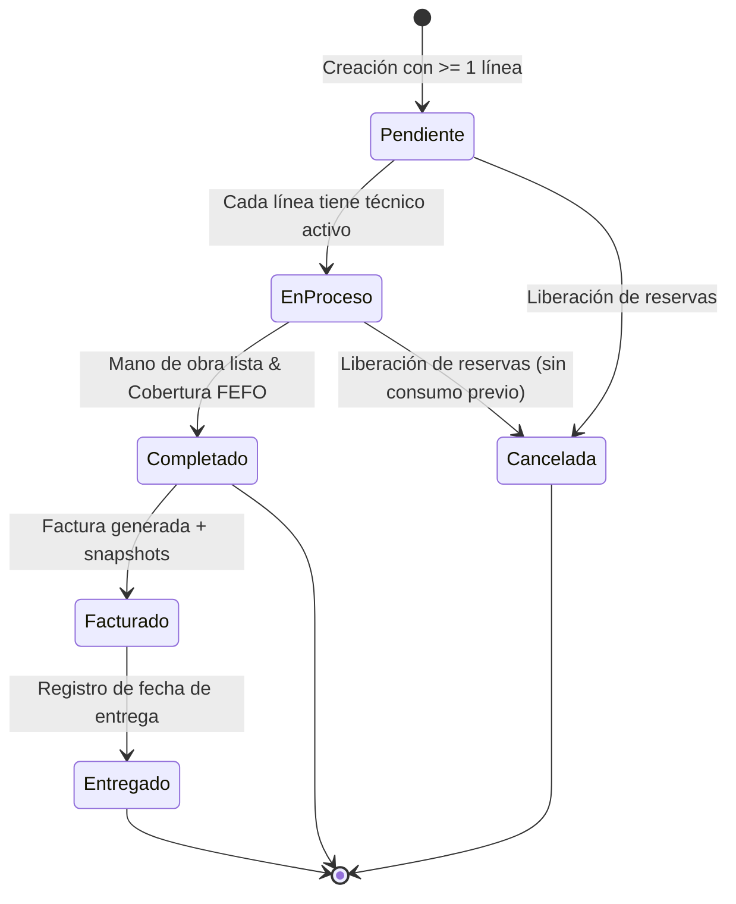

# Módulo 05 — Servicios & Órdenes de Trabajo

## 1. Identificación
- **Rama asociada:** `feature/gestion-servicios`
- **Agente especialista:** `@agent-servicios`
- **Dependencias:** `feature/gestion-clientes`, `feature/gestion-inventario`, `feature/gestion-tecnicos`
- **Requerimientos Funcionales:** RF-08, RF-09, RF-10, RF-11, RF-12, RF-13, RF-14, RF-15, RF-16, RF-35
- **Reglas de Negocio:** RN-01 a RN-08, RN-11, RN-12, RN-18, RN-22
- **Historias de Usuario:** [[HU-04]], [[HU-05]], [[HU-06]], [[HU-07]], [[HU-08]]
- **Patrón de Diseño aplicado:** **State** (ciclo estricto de transiciones de orden)

---

## 2. Entidades del Dominio (Cabecera-Detalle)
- **`OrdenServicio`:** `id`, `vehiculo_id` (FK), `estado_id` (FK), `fecha_recepcion`, `fecha_completado`, `fecha_entrega`, `fecha_cancelacion`, `descripcion_problema`.
- **`OrdenServicioDetalle` (Línea):** `id`, `orden_id` (FK), `servicio_tipo_id` (FK), `nombre_servicio_snapshot`, `costo_mano_obra` (BigDecimal >= 0), `observaciones`.
- **`DetalleTecnicos`:** `detalle_id` (PK, FK), `tecnico_id` (PK, FK), `horas_trabajadas` (BigDecimal >= 0).
- **`DetalleRepuestos`:** `detalle_id` (PK, FK), `repuesto_id` (PK, FK), `cantidad_asignada` (int > 0), `nombre_repuesto_snapshot`, `precio_unitario_venta` (BigDecimal).

---

## 3. Máquina de Estados (RN-06, Ciclo de Vida)

- **Inmutabilidad:** Una vez en `Completado`, las líneas, técnicos, repuestos y snapshots quedan completamente bloqueados contra edición o borrado.

---

## 4. Algoritmo de Descuento FEFO (RN-03, RN-04)
Al invocar `completarOrden()`:
1. Verificar que el stock operativo actual cubra las cantidades requeridas de cada repuesto.
2. Si un lote venció y generó déficit, rechazar la finalización y emitir alerta.
3. Descontar en orden determinista:
   - Lotes con fecha de caducidad antes que sin caducidad.
   - Entre los que tienen caducidad: fecha más próxima primero.
   - Empate: fecha de ingreso más antigua.
   - Empate final: menor ID de lote.
4. Reducir `lotes.cantidad_actual` y descontar `repuestos.cantidad_reservada`.
5. Cambiar estado a `Completado` y registrar `fecha_completado`.
6. **Todo dentro de una única transacción JDBC (`setAutoCommit(false)`, `commit()`, `rollback()`)**.
