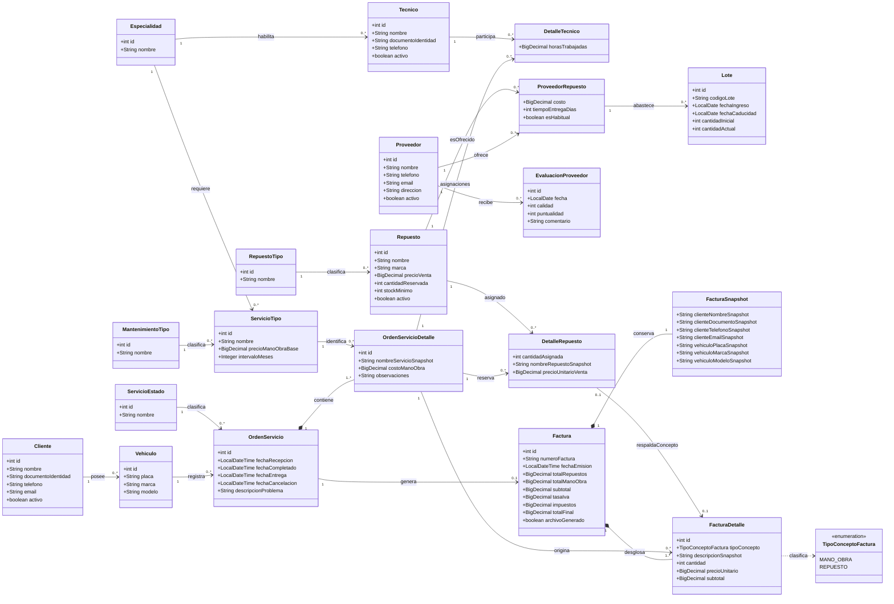

# Diagrama de Clases UML (dominio persistente)

Clases del dominio derivadas de las 20 tablas del modelo lógico. Las operaciones de negocio viven en `service`, no en estas clases.

> [!warning] Documento derivado (no editar a mano)
> Generado desde [[00-Documento-Maestro-v1.3]] por `scripts/sync-vault-from-master.ps1`.
> Cualquier corrección se hace en el maestro y se regenera: así no hay dos versiones de la verdad.

### 2.9 Diagrama de clases UML derivado del modelo lógico

El siguiente diagrama representa las **clases del dominio persistente** a partir de las 20 tablas del modelo lógico actualizado. Las claves foráneas se expresan como asociaciones UML; no se repiten como atributos de clase cuando la relación ya las representa. Las tablas intermedias M:N se modelan como clases de asociación (`DetalleTecnico`, `DetalleRepuesto` y `ProveedorRepuesto`) porque contienen atributos propios.

El diagrama se concentra en atributos y relaciones. No inventa métodos de negocio: las operaciones de aplicación se implementarán en las clases de servicio, controladores y DAOs, y deberán diseñarse durante la arquitectura Java. `TipoConceptoFactura` se representa como enumeración porque restringe los tipos de fila de factura, aunque no constituye una tabla independiente.

#### Criterios de lectura del UML

- Una `Factura` compone exactamente un `FacturaSnapshot` y uno o varios `FacturaDetalle`. La composición representa que esos registros históricos nacen con la factura y no tienen sentido independiente.
- Una `FacturaDetalle` siempre procede de una `OrdenServicioDetalle`. Puede ser de mano de obra o de repuesto; en el segundo caso debe corresponder a una asignación concreta de `DetalleRepuesto`.
- `DetalleTecnico`, `DetalleRepuesto` y `ProveedorRepuesto` son clases de asociación: materializan relaciones M:N y almacenan atributos que pertenecen a la relación, no solo a una de las entidades relacionadas.
- `Lote` se relaciona con `ProveedorRepuesto`, no libremente con cualquier combinación proveedor/repuesto. Así se conserva la regla de que el proveedor debe ofrecer el repuesto que ingresa.
- El diagrama UML no sustituye el diagrama lógico: el primero modela clases y asociaciones del dominio; el segundo especifica tablas, claves y restricciones de persistencia.

> [!note] Exportaciones pendientes
> Fuente editable: `02-Arquitectura/diagramas/CarMotors_Diagrama_Clases_UML_v1.3.mmd`. Los PNG/SVG se exportan desde ese archivo cuando se necesiten.
