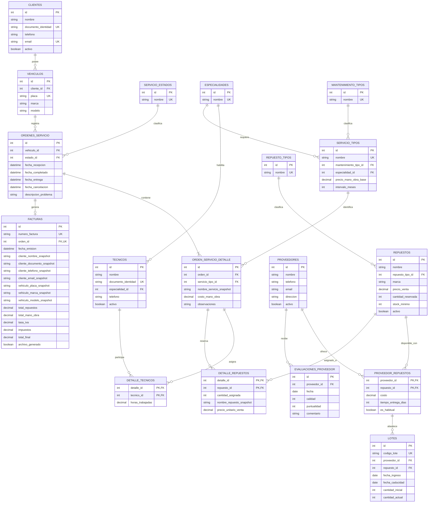

# Modelo Relacional & Diccionario de Datos

Entidades, claves, catálogos y cardinalidades del SGT. El detalle de cálculos de inventario vive en [[03-Inventario]] y el de snapshots en [[06-Facturacion]].

> [!warning] Documento derivado (no editar a mano)
> Generado desde [[00-Documento-Maestro-v1.2]] por `scripts/sync-vault-from-master.ps1`.
> Cualquier corrección se hace en el maestro y se regenera: así no hay dos versiones de la verdad.

### 2.1 Modelo lógico relacional

**Convenciones:** `PK` = clave primaria; `FK` = clave foránea; `UK` = restricción única; `PK/FK` = atributo que forma parte de una clave primaria compuesta y a la vez es clave foránea.

#### Lectura del diagrama

- `ORDEN_SERVICIO_DETALLE` es la tabla de líneas de servicio de cada orden.
- `DETALLE_TECNICOS` resuelve la relación M:N entre líneas de servicio y técnicos.
- `DETALLE_REPUESTOS` resuelve la relación M:N entre líneas de servicio y repuestos. La clave compuesta evita repetir el mismo repuesto dos veces en una misma línea; para reservar más unidades, se actualiza `cantidad_asignada`.
- `PROVEEDOR_REPUESTOS` resuelve la relación M:N entre proveedores y repuestos. La clave primaria compuesta evita repetir el mismo par.
- `LOTES` referencia el par `(proveedor_id, repuesto_id)` de `PROVEEDOR_REPUESTOS`. Así, cada lote pertenece a un proveedor que figura en el catálogo del repuesto.
- `FACTURAS.orden_id` es FK y UK: una orden puede tener cero o una factura, y una factura pertenece a una única orden.
- `Cancelada` forma parte del catálogo de estados y de las transiciones permitidas.

### 2.2 Diccionario lógico de entidades

Los nombres y atributos siguientes definen el diseño lógico. Los tipos concretos, longitudes, precisión decimal y acciones `ON DELETE` / `ON UPDATE` se concretarán en el modelo físico.

| Tabla | Claves | Atributos principales | Responsabilidad |
|---|---|---|---|
| `clientes` | `id` PK; `documento_identidad` UK; `email` UK | nombre, documento_identidad, telefono, email, activo | Datos del cliente; se conserva el historial al desactivar. |
| `vehiculos` | `id` PK; `cliente_id` FK; `placa` UK | cliente_id, placa, marca, modelo | Vehículos asociados a un cliente. |
| `servicio_estados` | `id` PK; `nombre` UK | nombre | Catálogo de estados de una orden. Incluye Cancelada. |
| `ordenes_servicio` | `id` PK; `vehiculo_id` FK; `estado_id` FK | fecha_recepcion, fecha_completado, fecha_entrega, fecha_cancelacion, descripcion_problema | Cabecera de cada visita y estado global de la orden. |
| `orden_servicio_detalle` | `id` PK; `orden_id` FK; `servicio_tipo_id` FK | nombre_servicio_snapshot, costo_mano_obra, observaciones | Una fila por servicio incluido en la orden. |
| `mantenimiento_tipos` | `id` PK; `nombre` UK | nombre | Catálogo Preventivo / Correctivo. |
| `especialidades` | `id` PK; `nombre` UK | nombre | Catálogo compartido por técnicos y tipos de servicio. |
| `servicio_tipos` | `id` PK; `nombre` UK; `mantenimiento_tipo_id` FK; `especialidad_id` FK | precio_mano_obra_base, intervalo_meses | Catálogo de servicios, especialidad requerida y parámetros de mantenimiento. |
| `tecnicos` | `id` PK; `documento_identidad` UK; `especialidad_id` FK | nombre, documento_identidad, telefono, activo | Personal que se puede asignar a líneas de servicio. |
| `detalle_tecnicos` | PK compuesta (`detalle_id`, `tecnico_id`); ambas FK | horas_trabajadas | Técnicos asignados a cada línea y horas registradas por técnico. |
| `repuesto_tipos` | `id` PK; `nombre` UK | nombre | Catálogo de categorías de repuestos. |
| `repuestos` | `id` PK; `repuesto_tipo_id` FK | nombre, marca, precio_venta, cantidad_reservada, stock_minimo, activo | Catálogo de repuestos y agregado de reservas. El stock físico y operativo se derivan de lotes; no se guarda `cantidad_stock` como saldo duplicado. |
| `proveedores` | `id` PK | nombre, telefono, email, direccion, activo | Datos de proveedores; se conserva su historial. |
| `proveedor_repuestos` | PK compuesta (`proveedor_id`, `repuesto_id`); ambas FK | costo, tiempo_entrega_dias, es_habitual | Catálogo M:N de repuestos ofrecidos y condiciones actuales por proveedor. |
| `lotes` | `id` PK; `codigo_lote` UK; FK compuesta (`proveedor_id`, `repuesto_id`) | fecha_ingreso, fecha_caducidad, cantidad_inicial, cantidad_actual | Existencias físicas restantes por ingreso y proveedor. `cantidad_actual` incluye unidades reservadas hasta que se consumen. |
| `evaluaciones_proveedor` | `id` PK; `proveedor_id` FK | fecha, calidad, puntualidad, comentario | Historial de evaluaciones de proveedores. |
| `detalle_repuestos` | PK compuesta (`detalle_id`, `repuesto_id`); ambas FK | cantidad_asignada, nombre_repuesto_snapshot, precio_unitario_venta | Repuestos asignados a una línea, cantidad reservada y precio/nombre histórico. Al completar la orden, `cantidad_asignada` se considera consumida. |
| `facturas` | `id` PK; `numero_factura` UK; `orden_id` FK y UK | fecha_emision, snapshots de cliente y vehículo, totales, tasa_iva, impuestos, total_final, archivo_generado | Cabecera inmutable de la factura interna y estado de generación del TXT. |

### 2.3 Catálogos de consulta

Los catálogos se cargan inicialmente desde `database/data.sql`. En esta versión no se exige un módulo de consola para administrar los tipos de servicio, tipos de repuesto, estados, tipos de mantenimiento o especialidades. Cualquier ampliación debe realizarse de forma controlada.

| Catálogo | Valores iniciales / condición |
|---|---|
| `servicio_estados` | Pendiente, En Proceso, Completado, Facturado, Entregado, Cancelada. |
| `mantenimiento_tipos` | Preventivo, Correctivo. |
| `repuesto_tipos` | Mecánico, Eléctrico, Carrocería, Consumo (aceites, filtros), entre otros. |
| `especialidades` | Mecánica general, Motor, Frenos, Eléctrica, Suspensión y dirección, Carrocería. |

Condiciones del catálogo `servicio_tipos`:

- Si el tipo de mantenimiento es **Preventivo**, `intervalo_meses` debe ser mayor que cero.
- Si el tipo de mantenimiento es **Correctivo**, `intervalo_meses` debe ser `NULL`.
- El precio base de mano de obra no puede ser negativo.

### 2.4 Relaciones y cardinalidades

| Relación | Cardinalidad | Implementación |
|---|---|---|
| Cliente — Vehículos | 1:N | `vehiculos.cliente_id` |
| Vehículo — Órdenes | 1:N | `ordenes_servicio.vehiculo_id` |
| Estado — Órdenes | 1:N | `ordenes_servicio.estado_id` |
| Orden — Líneas de servicio | 1:N | `orden_servicio_detalle.orden_id` |
| Tipo de servicio — Líneas | 1:N | `orden_servicio_detalle.servicio_tipo_id` |
| Línea — Técnicos | M:N | `detalle_tecnicos` |
| Especialidad — Técnicos | 1:N | `tecnicos.especialidad_id` |
| Especialidad — Tipos de servicio | 1:N | `servicio_tipos.especialidad_id` |
| Tipo de mantenimiento — Tipos de servicio | 1:N | `servicio_tipos.mantenimiento_tipo_id` |
| Línea — Repuestos | M:N | `detalle_repuestos` |
| Tipo de repuesto — Repuestos | 1:N | `repuestos.repuesto_tipo_id` |
| Proveedor — Repuestos | M:N | `proveedor_repuestos` |
| Relación proveedor-repuesto — Lotes | 1:N | FK compuesta en `lotes` |
| Proveedor — Evaluaciones | 1:N | `evaluaciones_proveedor.proveedor_id` |
| Orden — Factura | 1:0..1 | `facturas.orden_id` único |

La regla de que una orden debe tener al menos una línea se valida en el servicio que crea la orden y dentro de la transacción que guarda cabecera y líneas. Una FK por sí sola no garantiza el mínimo de una línea.
