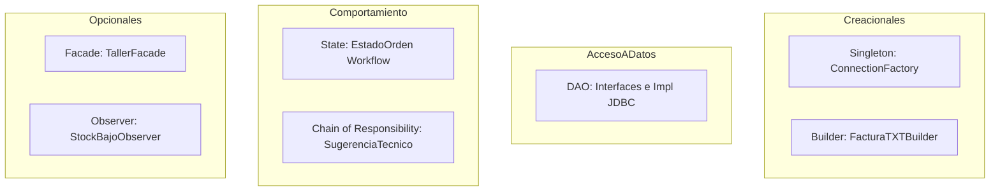

# Patrones de Diseño — CarMotors SGT

En cumplimiento con la rúbrica académica (mínimo 5 patrones demostrables con colaboración de clases verificable y explicable por el equipo):

---

## 1. Patrones Base (Obligatorios para Sustentación)

### 1.1 Singleton — `ConnectionFactory` (Creacional GoF)
- **Propósito:** Cargar `config.properties` una única vez y proveer acceso centralizado a conexiones.
- **Implementación segura:** No comparte una única conexión `Connection` global entre llamadas (evita colisiones). Cada llamada a `getConnection()` obtiene una conexión nueva.
- **Justificación:** Centraliza configuración y driver JDBC sin duplicar lectura de disco.

### 1.2 DAO (Data Access Object — JEE Core Pattern)
- **Propósito:** Desacoplar la lógica de persistencia SQL de las reglas de negocio.
- **Estructura:** Interfaces (`ClienteDAO`, `RepuestoDAO`, `OrdenServicioDAO`...) e implementaciones JDBC concretas (`ClienteDAOImpl`...).
- **Regla:** Ni vistas ni controladores interactúan con DAOs; solo los servicios.

### 1.3 Builder — `FacturaTXTBuilder` (Creacional GoF)
- **Propósito:** Construir paso a paso el formato de salida del archivo `factura_<numero>.txt` a partir de datos inmutables y snapshots históricos.
- **Estructura:** Métodos fluidos (`conEncabezado()`, `conDatosCliente()`, `conLineasServicio()`, `conDesgloseRepuestos()`, `conTotales()`, `build()`).
- **Justificación:** Formateo tabular limpio en consola y archivo TXT sin concatenaciones engorrosas en el servicio.

### 1.4 State — `EstadoOrden` (Comportamiento GoF)
- **Propósito:** Controlar las transiciones válidas y operaciones permitidas según el estado de la orden (Pendiente, En Proceso, Completado, Facturado, Entregado, Cancelada).
- **Estructura:** Interfaz `EstadoOrden` y clases concretas `EstadoPendiente`, `EstadoEnProceso`, etc. Cada estado sabe a cuál puede transicionar y rechaza saltos o retrocesos inválidos con `TransicionEstadoInvalidaException`.
- **Justificación:** Reemplaza estructuras monolíticas de `switch/case` y garantiza que las órdenes completadas queden selladas contra edición.

### 1.5 Chain of Responsibility — `SugerenciaTecnicoChain` (Comportamiento GoF)
- **Propósito:** Implementar la lógica jerárquica de sugerencia de técnicos (RN-20).
- **Estructura:**
  - `ManejadorSugerencia` (abstract handler).
  - `ManejadorEspecialistaLibre` (carga = 0).
  - `ManejadorEspecialistaMenorCarga`.
  - `ManejadorGeneralMenorCarga`.
- **Justificación:** Cumple el principio Open/Closed (OCP): se pueden añadir nuevos criterios de asignación sin modificar los anteriores.

---

## 2. Patrones Opcionales (Ampliaciones si el profesor exige 7)
- **Facade (`TallerFacade`):** Unifica operaciones coordinadas de alto nivel (crear orden completa con líneas y reservas en un solo llamado para la vista).
- **Observer (`StockObserver`):** Suscriptor notificado cuando un repuesto queda por debajo de su stock mínimo tras un consumo.
