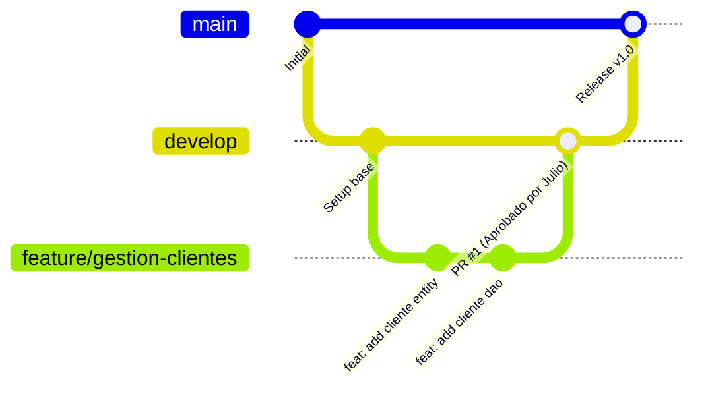

# Convenciones de Git Flow & Commits

## 1. Estructura de Ramas
- **`main`:** Código de producción estable. Solo recibe integraciones probadas mediante Pull Request y con aprobación de `@julio7879`.
- **`develop`:** Rama de integración continua del equipo (Rama por defecto del repositorio).
- **`feature/<nombre>`:** Ramas de funcionalidad creadas exclusivamente a partir de `develop`.
- **`fix/<nombre>`:** Ramas para corrección de bugs sobre `develop`.

---

## 2. Flujo de Trabajo para el Equipo



1. **Crear rama desde develop:**
   ```bash
   git checkout develop
   git pull origin develop
   git checkout -b feature/nombre-de-tu-tarea
   ```
2. **Hacer commits frecuentes y atómicos:** Usar siempre Conventional Commits en inglés.
3. **Subir rama:**
   ```bash
   git push -u origin feature/nombre-de-tu-tarea
   ```
4. **Abrir Pull Request hacia `develop`:**
   - Vincular el Issue (`Closes #X`).
   - Llenar el checklist del template de PR.
   - Solicitar revisión al líder (`@julio7879`).

---

## 3. Conventional Commits (RNF-19)
Todos los commits deben seguir el estándar:
`tipo: descripción breve en imperativo y minúsculas (inglés)`

- `feat:` Nueva funcionalidad para el usuario.
- `fix:` Corrección de un defecto o bug.
- `docs:` Cambios en README, documentación o bóveda.
- `refactor:` Reestructuración de código sin alterar comportamiento.
- `test:` Inclusión o ajuste de pruebas unitarias.
- `chore:` Tareas de configuración, Maven, `.gitignore`, dependencias.

*Ejemplos:*
- `feat: add FEFO stock deduction algorithm in service completion`
- `fix: prevent reserving expired lots when creating lines`
- `docs: update relational model diagram in vault`
- `chore: configure connection factory and properties example`
